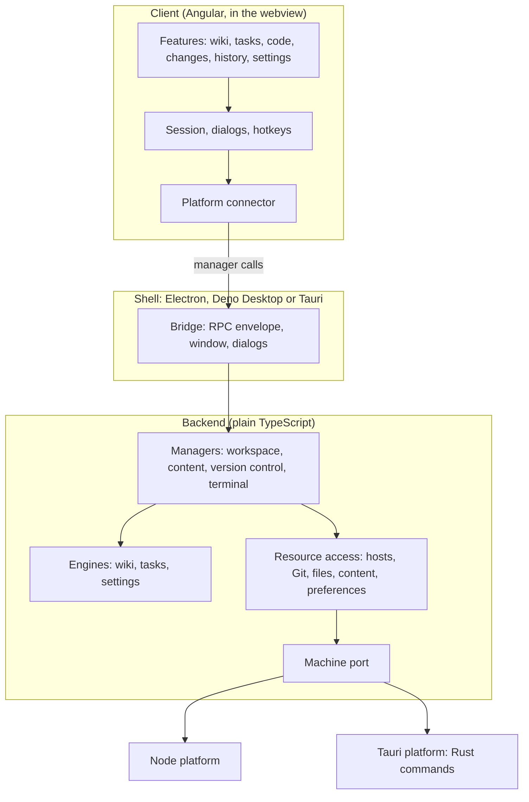

# Architecture

GitDesk is decomposed by volatility, following the iDesign Method: each layer hides one thing that is likely to change, and calls only go down.

| Layer | Folder | Hides | May use |
| --- | --- | --- | --- |
| Contracts | `src/contracts/` | Nothing: the types every layer agrees on, the RPC envelope and the shell bridges | — |
| Utilities | `src/utilities/` | Path rules, hashing, queues, tree building | contracts |
| Engines | `src/engines/` | The rules for tasks, wiki pages and settings. Pure functions, no I/O | contracts, utilities |
| Resource access | `src/access/` | Where repositories live (local, WSL, SSH), how Git is called, how files and preferences are stored | contracts, utilities, the Machine port |
| Managers | `src/managers/` | The use cases: open a repository, save a page, commit. One per area of change | engines, access |
| Platforms | `src/platforms/` | The machine itself: Node's `fs`, `child_process` and node-pty, or Tauri's Rust commands | contracts |
| Shells | `src/shells/` | The desktop runtime: window, IPC, menus, packaging | everything below |
| Client | `src/client/` | The user interface | contracts only; reaches the managers through its platform connector |

ESLint enforces the table: a layer that imports from a layer it may not use fails the lint, and `node:*` modules are only allowed in platforms and shells.

[SUBPAGES]
