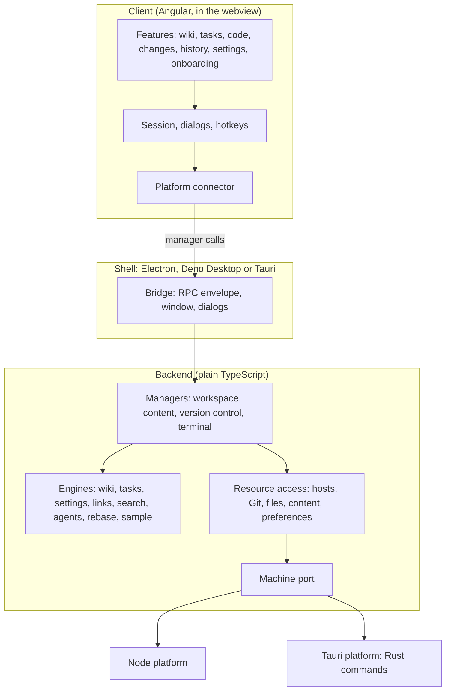

# Architecture

Genbeya is decomposed by volatility, following the iDesign Method: each layer hides one thing that is likely to change, and calls only go down.

| Layer | Folder | Hides | May use |
| --- | --- | --- | --- |
| Contracts | `src/contracts/` | Nothing: the types every layer agrees on, the RPC envelope and the shell bridges | — |
| Utilities | `src/utilities/` | Path rules, hashing, queues, tree building, version numbers | contracts |
| Engines | `src/engines/` | The rules for tasks and their comments and activity, wiki pages, settings, link rewriting, search results, interactive rebases and the AI agent files, and the sample repository's content. Pure functions, no I/O | contracts, utilities |
| Resource access | `src/access/` | Where repositories live (local, WSL, SSH), how Git is called, how files and preferences are stored | contracts, utilities, the Machine port |
| Managers | `src/managers/` | The use cases: open a repository, save a page, commit. One per area of change | engines, access |
| Platforms | `src/platforms/` | The machine itself: Node's `fs`, `child_process` and node-pty, or Tauri's Rust commands | contracts |
| Shells | `src/shells/` | The desktop runtime: window, IPC, menus, packaging | everything below |
| Client | `src/client/` | The user interface | contracts only; reaches the managers through its platform connector |

ESLint enforces the table: a layer that imports from a layer it may not use fails the lint, and `node:*` modules are only allowed in platforms and shells.

Within the client, features use the core services and the generic building blocks in `ui/` (dialogs, trees, menus, the guided tour); only `core/` talks to the platform connector.

| Page | Covers |
| --- | --- |
| [Managers](Architecture/Managers.md) | What the backend can do, call by call: snapshots, operations that stop, comments, search, moving pages, writes |
| [Hosts](Architecture/Hosts.md) | Repositories on this computer, on WSL and over SSH, and their terminals |
| [Content branch](Architecture/Content-branch.md) | Keeping the wiki, the tasks or the settings on a shared branch |
| [Runtimes](Architecture/Runtimes.md) | Electron, Tauri and Deno Desktop compared, with measurements |
| [Security](Architecture/Security.md) | How the app protects itself from the repositories it shows |
