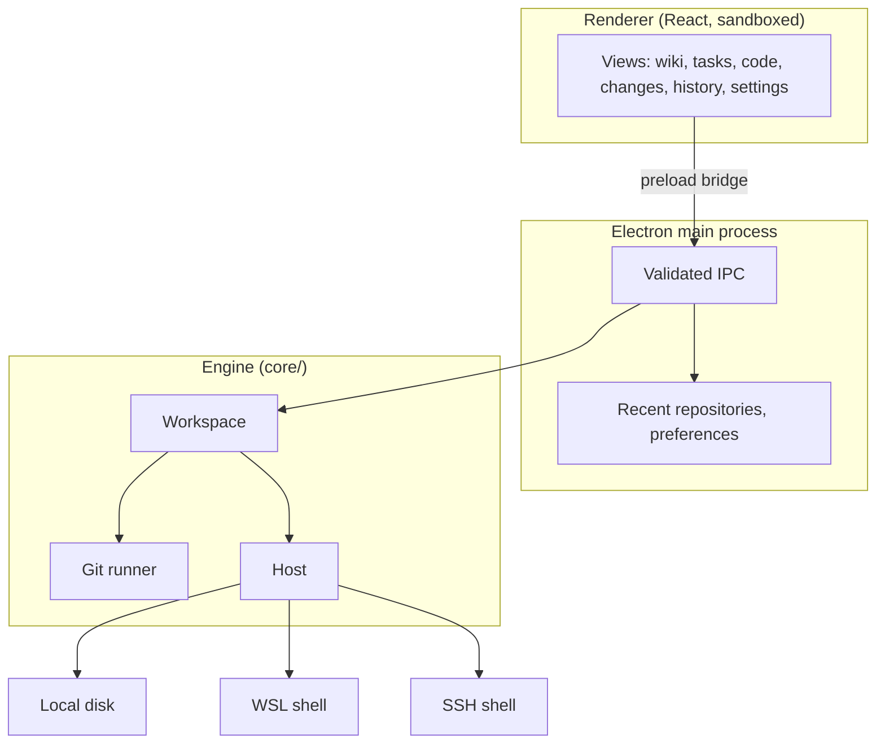

# Architecture

GitDesk is an Electron app with three layers. The engine knows nothing about Electron, and the renderer knows nothing about the file system.

| Folder | Responsibility |
| --- | --- |
| `core/` | Repository engine: files, wiki tree, tasks, Git operations, hosts. Plain Node. |
| `electron/` | Window, protocol, IPC, preferences, PlantUML rendering. |
| `shared/` | Types shared by all layers. |
| `src/` | The React renderer. |
| `tests/` | Engine tests against real repositories, UI tests in jsdom. |

[SUBPAGES]
