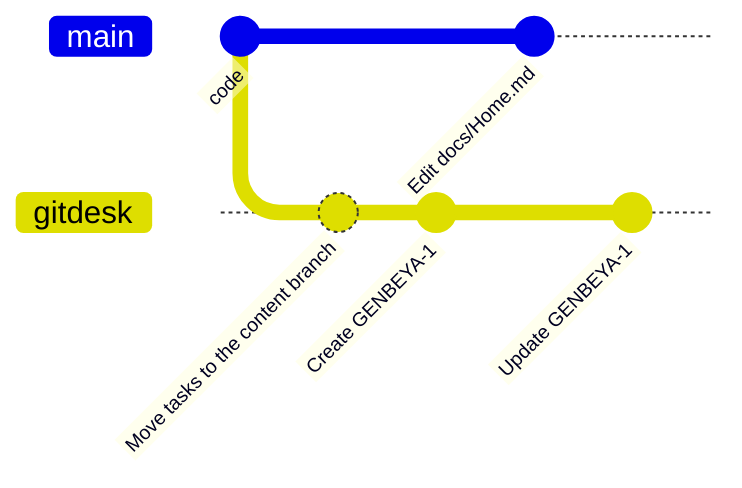

# Content branch

When many people work on many branches, wiki pages and tasks that change with every branch get in the way: the board looks different on each branch, and documentation edits wait for code to merge. A **content branch** keeps them on one shared branch instead, for each area separately.

## Areas

| Area | Files |
| --- | --- |
| Wiki | The wiki folder (`docs/`), and whatever else pages link to outside the task folder, such as images |
| Tasks | The task folder (`tasks/`) |
| Settings | `.gitdesk.yml` |

Each area lives either **in the checkout**, next to the code, or **on the content branch**. Typical layouts:

- **Docs with the code, tasks shared.** Documentation is reviewed and merged with the code it describes; the board is the same on every branch.
- **Everything shared.** Wiki, tasks and settings never depend on the checked-out branch.
- **Everything in the checkout** (the default). Content is just files in the repository.

## How it works

- The content branch is named `gitdesk` (or what `git config gitdesk.branch` says) and has no code.
- GitDesk checks it out as a separate worktree inside `.git/gitdesk/`, so your code checkout never changes.
- Every edit to an area on the content branch is committed there right away. Areas in the checkout behave like any other file: you commit them in **Changes**.
- **Sync** (sidebar, or the command palette) fetches the remote branch, rebases local edits on top and pushes. It only touches the content branch; files in the checkout go through Pull and Push as usual.
- Turn on **Settings → Sync automatically** to sync a few seconds after each edit.



## Choosing where each area lives

**Settings → Where content lives** has a choice per area.

**Moving an area to the content branch** creates the branch if neither this clone nor a remote has it (from an empty first commit), then copies the area's files as last committed on the checked-out branch onto it, replacing what the branch held for that area before; that earlier copy stays in the branch's history. The files on your code branches stay where they are; delete them in a normal commit once the team has switched.

**Moving an area back to the checkout** copies the branch's files into your checkout as uncommitted changes, including deletions, so you see the latest shared state in **Changes** and commit it like code. The branch keeps its copy, which GitDesk ignores until the area moves to the branch again.

Uncommitted changes in the area's folder of the checkout stop either move: they would be left behind, or replaced. Commit or discard them first. Nothing is deleted without a trace: whatever a move replaces is in a commit.

## Where the choice is stored

The layout belongs to the team, so it has to be shared. But GitDesk must know where `.gitdesk.yml` lives before it can read it, and the board must not move when someone switches code branches. The options:

| Option | Shared | Same on every code branch | Readable before the settings |
| --- | --- | --- | --- |
| A key in `.gitdesk.yml` | Yes | Only when the settings are on the content branch | No: the file's location is what we are looking for |
| `git config` keys per clone | No: everyone configures by hand, and a forgotten clone shows a different board | Yes | Yes |
| **A file on the content branch** | Yes, through sync | Yes | Yes: Git reads it straight from the branch's commit |

So the content branch carries `.gitdesk-content`, in Git's config format:

```ini
# Where GitDesk keeps each area: "branch" is this content branch,
# "checkout" is the checked-out code branch of every clone.
[areas]
	wiki = checkout
	tasks = branch
	settings = checkout
```

GitDesk writes it with every move, in the same commit, so the layout reaches others with their next sync. It reads the layout in this order:

1. `git config gitdesk.storage worktree` keeps every area of this clone in its checkout: a personal opt-out. Choosing a layout in Settings removes it, and the team's layout applies again.
2. Without a content branch, here or on a remote, every area is in the checkout.
3. Otherwise `.gitdesk-content` on the content branch (the local branch, else the remote one) decides. Areas it does not name are in the checkout; a branch without the file holds every area.

The file is read again whenever the branch's commit changes, such as after a sync brought a teammate's move.

## Existing repositories

Repositories keep working unchanged. A content branch made before areas existed has no `.gitdesk-content`, so it holds every area, as it did. A clone with `git config gitdesk.storage worktree` keeps everything in its checkout; a leftover `gitdesk.storage branch` changes nothing. The first move in Settings writes the file. Earlier GitDesk versions ignore the file and read every area from the branch, so update everyone before splitting areas.

## Other clones

Other clones pick the branch up automatically: if a remote has a content branch, GitDesk uses it with the layout its file describes. A move made elsewhere arrives with the next sync. Only the clone that moved an area back to the checkout gets the branch's files as changes; once committed and merged, everyone has them.

## Conflicts

Sync rebases. If two people changed the same lines of the same page, the rebase stops, GitDesk aborts it and reports the conflict; resolve it with Git in the content worktree (its path is in the message).

## In the code

`ContentStore` (`src/access/content/content-store.ts`) hides all of this: `layout()` says where each area lives, `locate(area)` gives the location (root, files, Git, branch) of one area, `record(area, …)` commits only when that area is on the branch, and `setStorage(area, mode, path)` moves one. `Workspace.locateContent(path)` names the location of any content path, for reading its files or its history.
