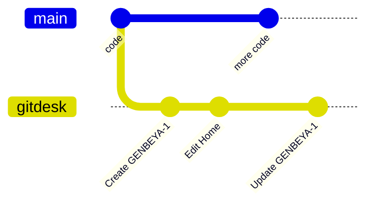

# Content branch

When many people work on many branches, wiki pages and tasks that change with every branch get in the way: the board looks different on each branch, and documentation edits wait for code to merge. A **content branch** keeps them on one shared branch instead.

## How it works

- Wiki pages, tasks and `.gitdesk.yml` live on a branch named `gitdesk`, which has no code.
- GitDesk checks that branch out as a separate worktree inside `.git/gitdesk/`, so your code checkout never changes.
- Every edit made in GitDesk is committed to the content branch right away.
- **Sync** (sidebar, or the command palette) fetches the remote branch, rebases local edits on top and pushes.
- Turn on **Settings → Sync automatically** to sync a few seconds after each edit.

## Turning it on

**Settings → Where wiki and tasks live → Dedicated branch.** If no `gitdesk` branch exists yet, GitDesk creates one from the committed wiki, tasks and settings of the current branch. The files on code branches stay where they are; delete them in a normal commit when the team has switched.

Other clones pick the branch up automatically: if a remote has a `gitdesk` branch, GitDesk uses it.

> [!NOTE]
> The branch name is `gitdesk` unless `git config gitdesk.branch <name>` says otherwise. `git config gitdesk.storage worktree` turns the feature off for one clone.

## Conflicts

Sync rebases. If two people changed the same lines of the same page, the rebase stops, GitDesk aborts it and reports the conflict; resolve it with Git in the content worktree (its path is in the message).
