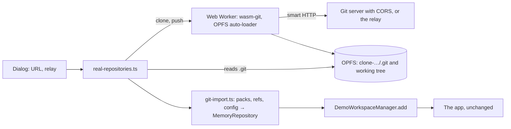

# Demo real repositories

Can the [Demo](Demo.md) open a visitor's own repository? This spike ([[GENBEYA-33]], branch `experiment/wasm-git-opfs`) clones a public repository into the browser with [wasm-git](https://github.com/petersalomonsen/wasm-git), keeps it in the origin private file system (OPFS), and imports it into the demo's in-memory model, so the demo managers open it as they open the sample. It works, and a commit made in the app can go back through libgit2 and be pushed. The demo's default behaviour is unchanged: all of it is behind `?real-repositories` in the address.

[TOC]

## How it works

wasm-git is libgit2's `lg2` example command line compiled to WebAssembly, not Git: it has no `rm`, no rebase, no `status --porcelain=v2`, none of the formats the access layer parses. So it doesn't replace the demo's model ([Demo](Demo.md) says why the demo doesn't run Git's command line); it is only the transport and the storage. The page reads the clone's Git directory itself and builds a `MemoryRepository` from it.

| Part | Where | What it does |
| --- | --- | --- |
| Opt-in | `connect.demo.ts` → `demo-connector.ts` | With `?real-repositories`, the demo's controls get `realRepositories`, a wrapper that loads the experiment's chunk on first use. Without it nothing changes, and the demo backend chunk is the same 233 kB |
| Entry | `features/demo/demo-badge.ts`, `features/welcome/welcome.ts`, `features/demo/real-repository-dialog.ts` | **Demo** menu and start screen: **Open a repository from a URL (experimental)**; the dialog clones, lists the clones stored in this browser to open or delete, and says which wasm-git build the browser gets. On an open clone, **Push new commits with wasm-git (experimental)** |
| Worker | `platform/real-repositories/wasm-git.worker.ts` | Loads `wasm-git/lg2_opfs_auto.js` (copied into the demo build only, `angular.json`), clones into `/opfs/clone-<url>`, and for the push records commits with `lg2 add` and `lg2 commit`, then `lg2 push` |
| Page side | `platform/real-repositories/real-repositories.ts` | Reads `.git` from OPFS (`navigator.storage.getDirectory()`, no WebAssembly needed to reopen), inflates with `DecompressionStream`, imports, and hands the repository to `DemoWorkspaceManager.add` |
| Git's formats | `src/access/memory/git-objects.ts` | Pack index version 2, packfiles with offset and ref deltas, loose objects, loose and packed refs, the config file |
| Import | `src/access/memory/git-import.ts` | Every commit the refs reach, each with its whole tree, under Git's IDs (`CommitStore.restore`); branches, remote-tracking branches, tags (annotated ones peeled, with their message), remotes, their HEADs and upstreams; HEAD checked out clean. Missing parents end the history, as in a shallow clone |
| Relay | `scripts/cors-relay.mjs` | A fetch handler, as a Cloudflare Worker exports one, run locally with Node; see [CORS](#cors-and-the-relay) |
| Test server | `scripts/git-test-server.mjs` | `git http-backend` with CORS and pushing allowed, on 127.0.0.1, for the push |
| Checks | `git-import.spec.ts`, `e2e/demo-real-repositories/`, `playwright.real-repositories.config.ts` | The importer against repositories made by the git CLI; the clone, reopen and push in the browser, with the network (so outside `npm run e2e:demo`) |

### Trying it

1. `npm run build:demo`, then `node scripts/serve-demo.mjs 4200` (add `--isolated` for the threaded build), and open http://127.0.0.1:4200/try/?real-repositories.
2. For GitHub and the other forges, `node scripts/cors-relay.mjs` and tick **Through a relay** (it listens on http://127.0.0.1:8787).
3. To push, `node scripts/git-test-server.mjs <folder of bare repositories>` and clone `http://127.0.0.1:8788/<name>.git`; commit in the app, then **Demo** → **Push new commits with wasm-git (experimental)**.
4. `npx playwright test --config playwright.real-repositories.config.ts` repeats the measurements below and writes them to `test-results-real-repositories/`.

The importer compares with Git: commit IDs and parents against `git log --all`, files against `git ls-tree`, dates against `%aI`, tags against `rev-parse v1^{commit}`.

## Measurements

Chromium 156 (Playwright 1.64) on Windows 11, `npm run build:demo` served by `scripts/serve-demo.mjs`, one run each; a cold start loads wasm-git's JavaScript and WebAssembly in under 0.1 s from the page's own origin. Heap is the page's JavaScript heap after a collection, before and after the import (`--enable-precise-memory-info --js-flags=--expose-gc`).

| | Small: wasm-git playground `/test` | Mid-sized: genbeya/genbeya |
| --- | ---: | ---: |
| History | 37 commits, 7 files | 373 commits, 673 files, 2,882 file versions (24 binary) |
| Git directory in OPFS | 48 kB (106 objects) | 3.2 MB (5,871 objects) |
| OPFS in all, with the working tree | 0.5 MB | 8.0 MB |
| Clone, JSPI build | 7.3 s | 3.4 s, through the local relay |
| Clone, threaded build (cross-origin isolated) | 7.2 s | 3.2 s |
| Native `git clone`, same machine | 7.4 s | 2.0 s |
| Import into the model | 0.06 s | 1.6–2.3 s |
| Reopen from OPFS after a reload, network cut off | 0.04 s | 1.6–2.3 s |
| Page heap added by the model | 4 MB | 59–63 MB |
| Worker: WebAssembly memory | 17 MB | 24 MB |
| Worker: copy of the clone in memory (JSPI and Asyncify builds only) | 0.5 MB | 7.9 MB |
| Push one commit (lg2 add, commit, push to the local test server), then import again | 0.5 s | not measured |

- The playground's server is slow for everyone: native Git takes as long. For genbeya/genbeya the relay fetched the 3 MB pack from GitHub in 0.8 s; the rest is libgit2 indexing and writing to OPFS.
- The import is dominated by inflating every object once with `DecompressionStream` (one stream per object). Caching the bases of deltas halved it (from 12,310 inflations to 5,874); a synchronous inflater such as pako would likely halve it again.
- The heap is the model's shape: each commit holds its whole tree as a `Map`, so memory grows with commits × files. Contents are shared between commits, so it is the maps, not the text, that cost. genbeya/genbeya's 373 × 673 entries take about 60 MB; a repository with 5,000 commits and 5,000 files would need around 25 million entries, beyond what a tab should hold. Larger repositories would need a shallow import (the importer already handles missing parents), or a model that keeps trees by ID.

## Browser support

| Browser | Build the auto-loader picks | Measured |
| --- | --- | --- |
| Chromium, default headers | JSPI (`lg2_opfs_jspi.js`): `WebAssembly.Suspending` exists, the page isn't isolated | Yes: clone, reopen, push |
| Chromium, COOP/COEP (`serve-demo.mjs --isolated`) | pthreads (`lg2_opfs.js`) on WasmFS | Yes: clone, reopen, push |
| Firefox | JSPI on Firefox 153 and later, which turns it on by default ([bug 2044809](https://bugzilla.mozilla.org/show_bug.cgi?id=2044809)); Asyncify (`lg2_opfs_async.js`) before | No: Windows refused to start Playwright's Firefox on the machine of the spike. Run the `firefox` project of `playwright.real-repositories.config.ts` to fill this in |
| Safari | Asyncify until JSPI ships | No |
| No OPFS (insecure context, some private modes) | None; the dialog says the browser can't keep a clone | — |

All OPFS builds need a worker. The JSPI and Asyncify builds keep a second copy of the clone in the worker's memory (MEMFS) and write through to OPFS, which costs memory as large as the clone; the threaded build reads and writes OPFS directly but needs the page to be cross-origin isolated, which would change how genbeya.fyi serves the demo (and every embedded resource must allow it).

Pitfalls found on the way:

- **WasmFS overwrites without truncating**: in the threaded build, writing a shorter file over a longer one keeps the old bytes at the start. The worker unlinks a file before writing it.
- **lg2's `add` doesn't stage deletions**, and `lg2 push` takes no arguments (it pushes the checked-out branch to its remote). The push refuses commits that delete files, merges, and a branch other than the clone's checked-out one.
- **lg2 prints errors and carries on**: a failed clone leaves no Git directory, which the page checks; a failed push shows in its output, which the page searches for `error`, `rejected` or `denied`.

## CORS and the relay

A page can only read responses from servers that allow its origin. GitHub, GitLab, Codeberg and Bitbucket send no CORS headers on Git's smart HTTP endpoints (checked: `info/refs` from GitHub has no `Access-Control-Allow-Origin`), so a browser can't clone from them directly.

| Option | Works with | Trust |
| --- | --- | --- |
| Servers that allow CORS, such as wasm-git's playground or a self-hosted [githttpserver](https://github.com/petersalomonsen/githttpserver) | The few that do | The visitor's browser talks to the server they named; nobody else is involved. The playground's push needs a sign-in with a NEAR wallet, so the spike pushes to `git-test-server.mjs` instead |
| A relay next to genbeya.fyi (`scripts/cors-relay.mjs` as a Cloudflare Worker) | Any public repository on an allowed host | genbeya.fyi sees which repositories visitors open and carries their traffic, and pays for it |
| A public CORS proxy | Anything | A third party sees and could alter every pack; not acceptable |

The relay is deliberately narrow:

- `<relay>/<host>/<path>/info/refs?service=git-upload-pack` and `…/git-upload-pack` only: fetching, never `git-receive-pack`, so it can't push anywhere;
- hosts on an allowlist (`github.com`, `gitlab.com`, `codeberg.org`, `bitbucket.org`), over https;
- pages on an allowlist (`https://genbeya.fyi`, `localhost`), checked by `Origin`;
- no credentials either way: only `Accept`, `Content-Type`, `Content-Encoding` and `Git-Protocol` are passed on, no cookies come back, and a 401 (a private repository) becomes "The repository isn't public";
- responses stream through, so a Worker doesn't hold the pack.

Even so, running it is a decision: it makes genbeya.fyi an open fetcher of public repositories for any page that fakes the `Origin` header (from outside a browser that's trivial), so it would need rate limits and a size cap per request. Its logs would show which repositories visitors try, which the privacy statement would have to say. Private repositories stay out of reach on purpose: they would need tokens in the browser and through the relay.

## What it changes about the demo's promise

The demo says *"Nothing you do is saved or sent anywhere, and reloading the page starts over."* With the experiment on, that is no longer true, and the demo would have to say so where the visitor opts in:

- **Sent**: the clone goes over the network, to the server the visitor names or through the relay, which then knows the repository. The push sends commits to the remote. Nothing else is sent: wiki edits, tasks and commits stay in the page until the visitor pushes.
- **Stored**: clones stay in this browser's OPFS for genbeya.fyi, with a `clone-….json` beside each (its URL, the relay's URL and when it was cloned), until the visitor deletes them in the dialog or clears the site's data. Reloading doesn't start over for them; the sample still does.
- **Content security policy**: the page's policy (`connect-src 'self'`) doesn't govern the worker, which gets its policy from the headers its own file is served with. genbeya.fyi's `_headers` would give the worker `connect-src` for the relay and for nothing else, and the page keeps its policy.
- **Untrusted content**: the demo would show repositories its authors never saw. The client's rules for that are the app's ([Security](Security.md)); the page has no machine behind it, so there is less to protect than in the app.

The demo's end-to-end test that no request leaves the page's origin still holds: it runs without `?real-repositories`.

## What it doesn't do

- **Binary files** are text in the model, so images come out mangled (24 of genbeya/genbeya's file versions). The model would need bytes for them.
- **Fetch, pull and push in the app** still talk to the simulated `origin` in memory, which starts as the clone's remote-tracking branches; only **Push new commits with wasm-git** reaches the real remote. Pulling new commits would mean `lg2 fetch` and importing again.
- **After a push** the clone is imported again: commits get Git's IDs (lg2 dates them anew), and changes not committed are gone.
- **Submodules** are left out; file modes (executable, symbolic links) aren't kept.
- **Large repositories** cost memory and import time in proportion to commits × files (see [Measurements](#measurements)).

## Recommendation

**Go, as an opt-in experiment; no-go for making it the demo's default.**

- The transport and storage are sound: wasm-git cloned, reopened from OPFS offline and pushed in both Chromium builds, at about native speed, and the importer reproduces Git's history exactly. Opening a repository you know in the demo is a much stronger first impression than the sample.
- What holds it back is outside the code: GitHub and the other forges need a relay, and a relay is a service to run, limit, pay for and describe in the privacy statement; and the demo's promise has to change for anyone who opts in.
- The model limits size: fine up to a few hundred commits and files, not for large repositories without a shallow import.

If it goes ahead, in this order: measure Firefox; import shallowly (the last 100 commits by default) to bound memory; keep binary files as bytes in the model; run the relay with rate limits and a size cap, and say what it logs; put the change to the promise in the dialog and on genbeya.fyi; then decide whether pulling should go through lg2 as the push does.
