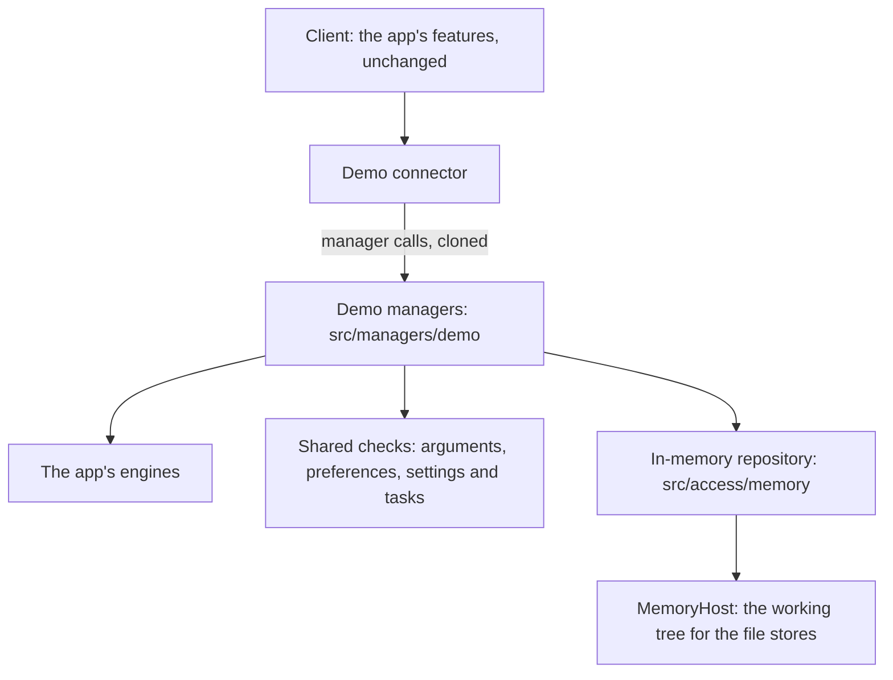

# Demo

The web demo runs Genbeya in a browser tab, with nothing to install and no server: [genbeya.fyi/try](https://genbeya.fyi/try/) serves it as static files. It opens the sample project, offers the tour, and lets visitors try the wiki, the board, the editor, search, Changes, History and Settings. The client is the app's own; the managers run in the page, on repositories that live in memory. Nothing is stored or sent anywhere, and loading the page again starts over.

| Part | Where | What it does |
| --- | --- | --- |
| Build | `angular.json` configuration `demo` | Replaces `platform/connect.ts` with `connect.demo.ts`, uses `index.demo.html` (the shells' content security policy as a meta tag), writes `dist/demo/browser` |
| Connector | `src/client/app/platform/demo-connector.ts` | Composes the demo backend in the page, as the Tauri connector does; keeps layout choices in memory; the folder picker offers the demo's folder, links open in a new tab, closing with unsaved edits asks as browsers do |
| Demo managers | `src/managers/demo/` | The four manager contracts on in-memory repositories; `demo-sample.ts` builds the sample's repository |
| Seed | `src/engines/demo-engine.ts` | The history the demo adds to the sample project |
| In-memory Git | `src/access/memory/` | Commits, index, working tree, refs, stashes, operations and remotes (`MemoryRepository`), Myers' diff, three-way merges, `.gitignore` rules, rename detection. Files are strings: text as itself, anything else, such as images, as its bytes behind a marker (`file-bytes.ts`) |
| Badge | `src/client/app/features/demo/demo-badge.ts` | **Demo** in the sidebar and on the start screen: what the demo is, **Reset demo** and **Download Genbeya** |

## Why the managers are reimplemented

There were two ways to run the backend in a page:

1. **The app's managers on a simulated machine**: an in-memory file system behind the Machine port, and `processes.run` answering `git` with a Git written in JavaScript.
2. **The manager contracts on an in-memory repository**, reusing everything below the managers that has no I/O.

The demo takes the second, because it is the one that stays in step with the app:

- The access layer speaks Git's command line: about 110 different invocations whose output it parses in exact formats (`status --porcelain=v2 -z`, NUL-separated name-status, custom `log` formats, `git grep` with columns, `log --follow` with whole-file patches), files it reads from the git directory (`MERGE_HEAD`, `rebase-merge/…`), patches it hands to `git apply --recount`, and interactive rebases driven by `GIT_SEQUENCE_EDITOR` and `exec` lines that Git's `sh` runs. isomorphic-git covers objects, status, commits, branches and a basic merge, but none of rebase, cherry-pick, revert, apply, grep, stash variants, reset modes or rename detection, and none of the command line. The first way means writing a Git command-line emulator, tied to every argument the access layer passes: a new flag there would break the demo at run time, unnoticed by the compiler.
- The second way is checked by the compiler: the demo managers implement the same contracts, so a new or changed call fails to build until the demo has it. What the managers decide is shared, not copied: the engines (tasks and their comments and activity, wiki pages, settings, link rewriting, search excerpts, people, agent files, staging patches, rebase todo lists, the sample), the argument checks (`version-control-arguments.ts`, `preference-change.ts`), reading the settings and the tasks (`readSettings`, `readTasks` in `workspace.ts`) and the file stores with their versions and refusals, which read and write the in-memory working tree through `MemoryHost`. What is written again is the orchestration of each call and Git itself, as a model rather than as a command line.

When you change a manager, look at its counterpart in `src/managers/demo/`; `demo-backend.spec.ts` drives the demo through the same RPC envelope as the client, and `e2e/demo/` drives the page.

## What the demo simulates

| Area | In the demo |
| --- | --- |
| Wiki, tasks, settings, code, search, people, agent files | The app's rules, on files in memory. Search matches with JavaScript regular expressions instead of `git grep` |
| Changes | Statuses with staged renames, `.gitignore`; staging files, hunks and lines through the patch engine, on unified diffs from Myers' algorithm; commit and amend; discard; stop tracking; stashes with untracked files or the index kept |
| History | The commit graph; branches and tags; merges with Git's conflict markers in the merge style; rebases, interactive ones and with autostash; cherry-picks and reverts; soft, mixed, hard and keep resets; undoing the last commit |
| Pull requests | The app's rules, with the branch comparison on the in-memory repository: commits ahead and behind, a three-way merge for conflicts, and the change ID from its unified diffs |
| Remotes | `origin` is a repository in memory: fetch, pull (fast-forward, or rebase), push, publish, force push with a lease, deleting remote branches and tags. Remotes you add are empty repositories in memory. Each request takes 0.4 s, as a network would |
| Content branch | Not available: every area stays in the checkout, and **Settings → Where content lives** says so |

The sample's repository starts with the sample project's three commits, and adds:

- the tag `v0.1`;
- the branch `fahrenheit`, two commits by Sam Rivera, whose merge into `main` conflicts in one line of `README.md`;
- two commits by Alex Chen on `main` that add an icon, `assets/icon.png`, and put a cloud in front of its sun, so **History** has an image to compare;
- a commit by Alex Chen on `main`;
- a commit by Sam on `main` with `pulls/PR-1.md`, a pull request for `fahrenheit` with a review topic, a suggestion and a request for Alex's review;
- all of it pushed to `origin`, which has one more commit on `main`, by Sam, that **Fetch** brings in;
- the sample's change to `src/forecast.ts`, left to commit.

Visitors commit and comment as *You* (`you@example.com`).

## What a browser can't do

- **Terminal**: the panel says *The terminal isn't available in the demo*.
- **Folders, WSL, SSH, cloning**: each explains that the demo can't reach them. The demo's machine has one folder, `/demo`, which holds the sample's repository and any sample project created from the start screen.
- **Shortcuts**: browsers keep Ctrl+1 to Ctrl+9 for their tabs, so the views' shortcuts don't reach the page; the sidebar and the command palette do.
- **Git's finer points**: diffs have no indent heuristic, so on repeated lines a change may sit a line away from where Git would put it; merges don't follow renames; a criss-cross merge takes the newest common ancestor instead of Git's recursive one.

## Nothing is kept

The demo promises to store nothing, so:

- preferences (theme, the tour, what's new) live in the demo's workspace manager, and layout choices (panel widths, board or list) in a `Map` the connector hands the client instead of local storage (`Remembered` in `ui/remembered.ts`);
- **Reset demo** and loading the page again start over;
- the page loads only its own files: fonts, KaTeX, Mermaid and rockuml's WebAssembly come with it.

The demo's end-to-end test checks that local storage, session storage and cookies stay empty, and that no request leaves the page's origin.

## Building and hosting

`npm run build:demo` writes the static site to `dist/demo/browser`. URLs are relative and views are in the address's hash, so it works under any path; [Development](../Development.md) has how to run it locally. Each release on GitHub carries it as `genbeya-web-demo.zip`.

| | Size |
| --- | ---: |
| Initial JavaScript and CSS | 517 kB (139 kB compressed) |
| The demo backend, loaded before the app starts | 233 kB (67 kB compressed) |
| Everything the first page loads (35 files, fonts included) | 1.6 MB (584 kB compressed) |
| The whole folder, mostly Mermaid's diagram chunks and rockuml's WebAssembly, loaded on demand | 20 MB (8.6 MB zipped) |

A host only has to serve the files, with `application/wasm` for `rockuml.wasm`. It may add the `frame-ancestors` part of the [content security policy](Security.md), which only works as a header.
