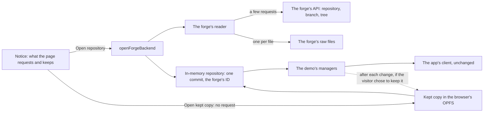

# Forges

**Genbeya on your forge** opens a repository on GitHub, GitLab, Bitbucket, Codeberg, Gitea or Forgejo in a browser tab, with its wiki, its task board and the code they refer to, without cloning it. The address is the forge's own with `genbeya.fyi/<forge>` in front: `github.com/acme/rockets` opens as `genbeya.fyi/github/acme/rockets`, `gitlab.com/acme/space/rockets` as `genbeya.fyi/gitlab/acme/space/rockets`. References render exactly as in the app, because it is the app's client, engines and the [Demo](Demo.md)'s managers.

> [!NOTE]
> This is the proof of concept of [[GENBEYA-57]], [[GENBEYA-58]] and [[GENBEYA-60]]: nothing is written back to the forge, public repositories open without signing in, private ones with a token, and a repository is kept in the browser only when the visitor chooses so. It is not yet served by genbeya.fyi; see [Hosting](#hosting) and [Next steps](#next-steps).

[TOC]

## How it works



| Part | Where | What it does |
| --- | --- | --- |
| Build | `angular.json` configuration `forge` | Like the demo's, with `connect.forge.ts` and `index.forge.html`; writes `dist/forge/browser` |
| Address | `src/utilities/forge-address.ts` | Each forge's addresses, `?host=` for servers of their own, and the hosts each forge's page connects to |
| Start screen | `src/client/app/platform/forge-notice.ts` | The notice, the choices, the progress and the errors, in plain DOM before the client starts; who runs each forge and its privacy statement |
| Connector | `src/client/app/platform/forge-connector.ts` | Composes the start screen, the keeper and the backend; saves after each change while the repository is kept, one tab at a time; the badge's words and choices (**GitLab** · owner/repo, **Open on GitLab**, **Keep in this browser**, **Delete the kept copy**) |
| Keeper | `src/managers/demo/forge-keeping.ts` | Kept repositories: a summary to list each by, and its whole state (`src/access/memory/repository-state.ts`) |
| Kept files | `src/access/browser/kept-files.ts` | The browser's Origin Private File System (OPFS), or a `Map` in tests |
| Backend | `src/managers/demo/forge-backend.ts` | Chooses what to read, builds the in-memory repository, and runs the demo's managers on it; fetching and pushing are refused |
| Readers | `src/access/forges/` | One per forge behind one interface (`forge.ts`: list a branch, read files), with errors a visitor can act on; `fetch` is injected |
| Simulated forges | `src/testing/fake-forges.ts` | The endpoints the readers use, for the unit tests and `e2e/forge/` |
| Server | `scripts/serve-forge.mjs` | Serves the build as genbeya.fyi will: the page at every address, with a content security policy per address |

The repository becomes one commit, the one the branch points to, under the forge's own commit ID, so **Copy web link** and links to commits lead to the same place on the forge. `origin` is the repository's clone URL, and the branch tracks it, up to date. Edits, commits, branches and the rest work as in the demo, in memory; **Fetch**, **Pull** and **Push** say that Genbeya in the browser doesn't fetch or push yet.

## Addresses

| Forge | Address | A branch | Server of its own |
| --- | --- | --- | --- |
| GitHub | `/github/<owner>/<repo>` | `/tree/<branch>` | No |
| GitLab | `/gitlab/<group>[/<subgroup>…]/<project>` | `/-/tree/<branch>` | `?host=`, gitlab.com otherwise |
| Bitbucket Cloud | `/bitbucket/<workspace>/<repo>` | `/src/<branch>` or `/tree/<branch>` | No |
| Codeberg | `/codeberg/<owner>/<repo>` | `/src/branch/<branch>` or `/tree/<branch>` | No |
| Gitea, Forgejo | `/gitea/<owner>/<repo>?host=<host>`, `/forgejo/…` | as Codeberg | Always: `?host=` is needed |

Wherever the page is served, `?forge=<forge>&repo=<owner>/<repo>&branch=<branch>&host=<host>` names a repository too, and `?repo=` alone a GitHub one; the start page uses this form. Names follow each forge's rules, branches Git's, and hosts are plain host names with an optional port: no IP addresses, no user names, no paths. Anything else is refused before a request is made.

## What it reads

Opening a repository costs a few API requests: the repository (default branch, privacy, clone URL), the commit of the branch, and its tree. Then it reads Genbeya's content, not the whole repository:

1. `.genbeya.yml`, which says where the wiki and the tasks are;
2. everything below the wiki and task folders, and every Markdown file (READMEs, `AGENTS.md`);
3. the files those name: `[[path]]` references and `![[path#L1-L9]]` embeds, and relative Markdown links and images.

Everything else stays on the forge; the badge says how many files. At most 3000 files and 30 MB are read, and no file over 1 MB; symbolic links and submodules are left out.

> [!IMPORTANT]
> Reading every file does not scale. The first version did: Genbeya's own repository is 706 files and 4.8 MB, which loaded in 13 seconds, and loading it twice within a few minutes made raw.githubusercontent.com answer *429 Too Many Requests*. Reading the content only, the same repository is 85 files, in about 3 seconds.

### Each forge

| Forge | Tree | Files | Token |
| --- | --- | --- | --- |
| GitHub | `git/trees/<sha>?recursive=1`, one request | Without a token `raw.githubusercontent.com/<owner>/<repo>/<commit>/<path>`, which doesn't count against the API's limit; with one the API's blobs | `Authorization: Bearer`; a fine-grained token that may read contents |
| GitLab (API v4) | `repository/tree?recursive=true`, pages of 100 through the `Link` header, without sizes | `repository/blobs/<id>/raw` | `Authorization: Bearer`; personal, project or group token with `read_api` |
| Gitea, Forgejo, Codeberg (API v1) | `git/trees/<sha>?recursive=true`, pages of up to 1000 | `raw/<path>?ref=<commit>` | `Authorization: token`; `read:repository` |
| Bitbucket Cloud (API 2.0) | `src/<commit>/?max_depth=50`, one listing through every folder, pages through `next` | `src/<commit>/<path>` | `Authorization: Bearer`; repository, project or workspace token with `repository:read` |

Readers follow at most 100 pages of a listing and then say the tree is cut short; they never follow a next page that leads off the forge's API.

A server of its own behind a proxy that ends TLS may believe it is reached over http (GitLab's `external_url`, Gitea's `ROOT_URL`) and name itself so: its next-page links and the repository's web and clone addresses then start with `http://` and its own host. Readers follow such a link over https, and show such addresses with https, since the page has just reached that host over https; an http link would also be blocked by the page's policy and as mixed content. A link to any other host or path is still refused, with a message that names it. GitLab lists no sizes, so its files over 1 MB are left out once they have arrived.

## What forges allow from a web page

Probed on 2026-11-09 with requests from the origin `https://genbeya.fyi`:

| Endpoint | From a web page | Notes |
| --- | --- | --- |
| `api.github.com` (REST) | Yes: `Access-Control-Allow-Origin: *`, rate limit headers exposed | 60 requests an hour without a token, which is 20 repositories opened; 5000 with one |
| `raw.githubusercontent.com` | Yes | Cached for 5 minutes; limits how fast one client reads |
| `codeload.github.com` (tarballs) | No | Only `render.githubusercontent.com` may read them |
| `github.com/login/oauth/access_token`, `github.com/login/device/code` | No | Signing in needs a relay, see [Next steps](#next-steps) |
| `api.github.com/graphql` | Documented to; couldn't be probed from the development environment | Later: many files in one request |
| gitlab.com API | Yes, with `Link` and `X-Total` exposed | |
| gitlab.com `/-/raw/` files | No | Files through the API instead |
| api.bitbucket.org | Yes | |
| Codeberg and gitea.com APIs | Yes, with `X-Total-Count` exposed | Codeberg limited the development environment's requests (429) while it was probed |
| Self-hosted Gitea and Forgejo | Only when the administrator enables CORS (`[cors] ENABLED = true`) | Off by default |
| Git itself (`info/refs` on github.com and gitlab.com) | No | See [Why the forge's API and not Git](#why-the-forges-api-and-not-git) |

Requests without a token carry no headers of their own, so browsers send them without a preflight. Requests with a token send `Authorization`, which needs one; the forges answer preflights, but this was not verified from a real browser yet.

### Why the forge's API and not Git

Git's own protocol endpoints answer no other origin, so Git in the page (compiled to WebAssembly, or isomorphic-git) could only clone through a proxy that adds the headers: a third party that sees every request, tokens included, and a clone of the whole history up front. The forges' APIs answer web pages and let the page read only the files it needs. History and writing back go through them too: commits from the commits API, edits as commits made through the API.

## Privacy

Genbeya's promise is privacy first: nothing is collected or sold, and everything that leaves the device or stays on it is the visitor's choice. Genbeya on your forge keeps that promise by design, not by policy alone: [[GENBEYA-61]] is the outside review of what follows, with the brief for reviewers in [Privacy review](Forges/Privacy-review.md).

### The notice

Every address of the page starts at the notice, and nothing is requested before the visitor chooses **Open repository**: the end-to-end tests open the page at every kind of address (with a branch, with a view in the hash, with the query, on a server of its own) and check that nothing reached a forge and none of the app ran. **Cancel** sends nothing and keeps nothing. The notice says, before anything happens:

- that the browser asks the forge for the files, and at which hosts;
- that whoever runs the forge sees the visitor's IP address and that the requests come from a page on genbeya.fyi. Browsers send an `Origin` header with every cross-origin request, and no page can suppress it; the page itself sends no referrer;
- under which privacy statement the forge processes the requests, linked, and where: GitHub, GitLab and Atlassian (Bitbucket) also in the United States; Codeberg e.V. under its privacy policy. For a server of its own, that whoever runs it does so under their own terms;
- that nothing goes anywhere else, nothing tracks the visitor, and nothing is written back to the forge;
- what keeping the repository means, in its own choice, off by default.

### Servers of their own

A link can name any host with `?host=`. The browser makes the requests, so a server reachable only over a VPN works, and genbeya.fyi never sees it; but a link could also name a host an attacker runs, to ask visitors for their token. So the notice opens with a warning that names the host and says Genbeya can't tell who runs it, the token field is labelled with the host it goes to, and nothing is ever filled in for the visitor.

### What leaves the device

| To | What | When |
| --- | --- | --- |
| The forge | Requests for the repository and its files: IP address, `Origin` of the page, the browser's own headers; with a token, the token, only to the forge's API | After the visitor chose **Open repository** or **Read again** |
| genbeya.fyi (its host) | Requests for the page's own files, which the hosting provider logs as for any website | When the page loads |
| Anyone else | Nothing | Never |

The content security policy enforces the last row. The page itself allows connections only to its own origin and https hosts; the server sends the policy again as a header for each address, allowing only the hosts of the forge the address names (`api.github.com` and `raw.githubusercontent.com`, `gitlab.com`, `api.bitbucket.org`, `codeberg.org`, or the named server), and browsers enforce both. The start page, which names no repository, connects nowhere. An end-to-end test checks that a page for one forge can't reach another.

The repository's content, which holds personal data such as commit authors, never reaches genbeya.fyi: it is processed in the visitor's browser, as by desktop software.

### What stays on the device

Nothing, unless the visitor chooses to keep the repository: no cookies, no local storage, no IndexedDB, and the tests check it. A kept repository lives in OPFS, see [Keeping a repository](#keeping-a-repository). Tokens are never kept: they are used while the files are read and then dropped; the managers that run afterwards never get them.

### Security

Repository content is shown by the same client, so [Security](Security.md) applies unchanged: Markdown through the allowlist, diagrams as images, remote images never loaded. Paths from a forge's tree pass the repository path rules, and names, branches and hosts are checked before any request.

## Keeping a repository

**Keep it in this browser** is a choice of its own on the notice, never ticked in advance, and **Keep in this browser** in the badge's menu asks first too. While it is on:

- The whole repository is saved to the browser's Origin Private File System (OPFS), a folder only pages of the site can reach: its commits, index, working tree, branches, tags, remote-tracking branches, stashes, conflicts and an operation in progress (`repository-state.ts`). Each file's content is saved once, however many commits hold it.
- Saving follows every call that changes something, a moment later, and when the page is hidden. A save writes nothing when nothing changed, and replaces the files at once: a write that fails leaves the last saved state.
- The page asks the browser not to evict kept files when space runs low (`navigator.storage.persist()`).
- One tab at a time keeps a repository (a Web Lock named after its forge, host and name); another tab can still open it without keeping it.

Kept repositories are told apart by forge, host, owner, name and branch, so the same names on two servers are two kept copies. The next visit to the repository's address shows the kept copy on the notice: **Open kept copy** opens it as it was saved and asks nothing of the forge. **Read again** reads the repository afresh; ticked, keeping it replaces the kept copy.

Deleting is as easy as keeping: **Delete kept copy** on the notice, **Delete the kept copy** in the badge's menu (the repository stays open in the tab), and **Delete everything kept** at the foot of the notice and the start page, which also says how much the browser keeps.

> [!NOTE]
> OPFS belongs to the origin, here every page of genbeya.fyi. Serving Genbeya on your forge from an origin of its own keeps what it stores apart from the rest of the site ([[GENBEYA-59]]).

## Hosting

The page's files use relative addresses, and its policy forbids `<base>`. Since the page is served at addresses of any depth (`/gitlab/acme/space/rockets/-/tree/feature/x`), the files live in one folder and the page's own references are made absolute: `scripts/serve-forge.mjs` serves the build below `/_app/` and the page at `/` and every forge address, with the policy for that address as a header. PlantUML's wasm is resolved next to the scripts (`new URL("rockuml.wasm", import.meta.url)`), so it is found at any depth too.

genbeya.fyi will do the same ([[GENBEYA-59]]) with a Worker, on an origin of its own such as `open.genbeya.fyi`, with `genbeya.fyi/<forge>/…` redirecting there. Browser storage and the content security policy belong to an origin: on its own origin, what Genbeya on your forge keeps can't be read by the rest of the site, and genbeya.fyi's promise (no request to another origin, nothing stored) stays literally true for every other page. The Worker must send the policy header: without it, the page's own policy allows any https host.

### The badge

A README links its repository on genbeya.fyi with the static badge [`branding/open-in-genbeya.svg`](../../branding/open-in-genbeya.svg):

```markdown
[](https://genbeya.fyi/github/<owner>/<repo>)
```

GitHub shows README images through its own image proxy, so readers' addresses don't reach genbeya.fyi. The badge is one file for every repository and must stay so: a badge made per repository would tell the server who reads which README, like a tracking pixel.

## Options considered

| Option | Verdict |
| --- | --- |
| **The web client on the forges' APIs** (this page) | Chosen: the board, the wiki and references as in the app, private repositories included, no server of our own except, later, a sign-in relay |
| A GitHub Action that publishes the wiki and the board to Pages | Cheap and needs no sign-in, but read-only and, on most plans, public even for private repositories; worth it later for open-source projects |
| Mirroring to GitHub's Wiki and Projects | Only one way, if at all: GitHub's wiki is a flat set of pages with its own `[[…]]` syntax (link text first) and no embeds, and Projects would need a second source of truth for status, comments and people |
| A browser extension | The only way to render references inside a forge's own pages; it breaks whenever the forge changes its markup. A later add-on, not the foundation |

## Limitations

- **History** is one commit: task activity shows the task as it is, and **History** shows only the branch's last commit.
- **Code** has only the files the wiki and tasks refer to.
- **Nothing is written back** to the forge; fetching and pushing are refused, also for a kept copy, which stays as it was read until it is read again.
- Files in **Git LFS** show their pointer text.
- **Content branch**: a repository that keeps its wiki or tasks on a content branch shows what its checkout has.
- **Not covered**: GitHub Enterprise Server and Bitbucket Data Center, whose APIs differ; Bitbucket's API tokens that sign in with an email address (Basic authentication).

## Next steps

- Sign in instead of pasting a token (a GitHub App, GitLab's OAuth). GitHub's token endpoints refuse web pages, so the code exchange needs a small stateless relay; the website already runs as a Cloudflare Worker.
- Serve it from genbeya.fyi, on an origin of its own, with the badge ([[GENBEYA-59]]), after the privacy review ([[GENBEYA-61]]).
- Fetch into a kept copy: what changed on the forge since, merged with the visitor's changes, which the in-memory repository can already merge.
- Write back: commit edits through the API (one commit per save, or a branch and a pull or merge request).
- History and task activity from the forges' commits; the content branch; reading many files per request; reading other files when they are opened.
