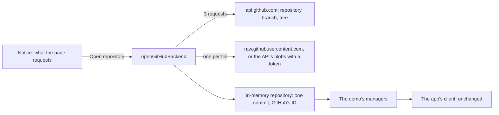

# GitHub

**Genbeya on GitHub** opens a repository on github.com in a browser tab, with its wiki, its task board and the code they refer to, without cloning it: `genbeya.fyi/github/<owner>/<repo>`, or `…/tree/<branch>` for a branch, the way GitHub spells it. Replacing `github.com` with `genbeya.fyi/github` in a repository's address opens it in Genbeya. References render exactly as in the app, because it is the app's client, engines and the [Demo](Demo.md)'s managers.

> [!NOTE]
> This is the proof of concept of [[GENBEYA-39]]: read-only (edits stay in the tab), public repositories without signing in, private ones with a token. It is not yet served by genbeya.fyi; see [Hosting](#hosting) and [Next steps](#next-steps).

[TOC]

## How it works

| Part | Where | What it does |
| --- | --- | --- |
| Build | `angular.json` configuration `github` | Like the demo's, with `connect.github.ts` and `index.github.html`, whose content security policy also allows connections to `api.github.com` and `raw.githubusercontent.com`; writes `dist/github/browser` |
| Address | `src/utilities/github-address.ts` | `/github/<owner>/<repo>[/tree/<branch>]`, or `?repo=<owner>/<repo>&branch=<branch>` wherever the page is served; GitHub's rules for names, Git's for branches |
| Connector | `src/client/app/platform/github-connector.ts` | The notice, the progress and the errors, in plain DOM before the client starts; then the demo's connector on the GitHub backend, and the badge's words (**GitHub** · owner/repo, **Open on GitHub**, **Read again from GitHub**) |
| Backend | `src/managers/demo/github-backend.ts` | Chooses what to read, builds the in-memory repository, and runs the demo's managers on it; fetching and pushing are refused |
| Reader | `src/access/github/github-reader.ts` | GitHub's REST API and raw files, with errors a visitor can act on; `fetch` is injected |
| Simulated GitHub | `src/testing/fake-github.ts` | The endpoints the reader uses, for the unit tests and `e2e/github/` |

The repository becomes one commit, the one the branch points to, under GitHub's own commit ID, so **Copy web link** and links to commits lead to the same place on github.com. `origin` is the repository's clone URL, and the branch tracks it, up to date. Edits, commits, branches and the rest work as in the demo, in memory; **Fetch**, **Pull** and **Push** say that Genbeya on GitHub doesn't fetch or push yet.

## What it reads

Opening a repository costs three API requests: the repository (default branch, privacy, clone URL), the commit of the branch, and its whole tree (`git/trees/<sha>?recursive=1`). Then it reads Genbeya's content, not the whole repository:

1. `.genbeya.yml`, which says where the wiki and the tasks are;
2. everything below the wiki and task folders, and every Markdown file (READMEs, `AGENTS.md`);
3. the files those name: `[[path]]` references and `![[path#L1-L9]]` embeds, and relative Markdown links and images.

Everything else stays on GitHub; the badge says how many files. At most 3000 files and 30 MB are read, and no file over 1 MB; symbolic links and submodules are left out.

> [!IMPORTANT]
> Reading every file does not scale. The first version did: Genbeya's own repository is 706 files and 4.8 MB, which loaded in 13 seconds, and loading it twice within a few minutes made raw.githubusercontent.com answer *429 Too Many Requests*. Reading the content only, the same repository is 85 files, in about 3 seconds.

Without a token, files come from `raw.githubusercontent.com/<owner>/<repo>/<commit>/<path>`, which allows any origin and doesn't count against the API's limit. With a token, they come from the API's blobs (`git/blobs/<sha>` with `Accept: application/vnd.github.raw+json`), one request per file.

## What GitHub allows from a web page

Probed on 2026-11-09 with requests from the origin `https://genbeya.fyi`:

| Endpoint | From a web page | Used for |
| --- | --- | --- |
| `api.github.com` (REST) | Yes: `Access-Control-Allow-Origin: *`, rate limit headers exposed | Repository, branch, tree; blobs with a token |
| `raw.githubusercontent.com` | Yes: `Access-Control-Allow-Origin: *`; cached for 5 minutes; limits how fast one client reads | Files without a token |
| `codeload.github.com` (tarballs) | No: only `render.githubusercontent.com` may read them | — |
| `github.com/login/oauth/access_token`, `github.com/login/device/code` | No: no CORS headers at all | Signing in needs a relay, see below |
| `api.github.com/graphql` | Documented to; couldn't be probed from the development environment | Later: many files in one request |

Requests without a token carry no headers of their own, so browsers send them without a preflight. Requests with a token send `Authorization`, which needs one; GitHub's API answers preflights, but this was not verified from a real browser yet.

Rate limits: without signing in, the API allows 60 requests an hour per IP address, which is 20 repositories opened; with a token, 5000, which is the number of files read too.

## Privacy and security

- **The notice comes first.** Nothing is requested before the visitor chooses **Open repository**; the notice names the two hosts and links GitHub's privacy statement.
- **Nothing else is contacted.** The content security policy allows connections only to the page's own origin, `api.github.com` and `raw.githubusercontent.com`; the page sends no referrer. Nothing is stored in the browser: no cookies, no local storage, as in the [Demo](Demo.md). The end-to-end tests check both.
- **Tokens** go only to `api.github.com`, are used while the files are read and are then dropped: the managers that run afterwards never get them.
- **Repository content** is shown by the same client, so [Security](Security.md) applies unchanged: Markdown through the allowlist, diagrams as images, remote images never loaded. Paths from GitHub's tree pass the repository path rules, and names and branches are checked before any request.

## Hosting

The page's files use relative addresses, and its policy forbids `<base>`. Since the page is served at addresses of any depth (`/github/acme/rockets/tree/feature/x`), the files live in one folder and the page's own references are made absolute: `scripts/serve-github.mjs` serves the build below `/github/_app/` and the page for every other address below `/github/`. No owner on GitHub can be called `_app`. PlantUML's wasm is resolved next to the scripts (`new URL("rockuml.wasm", import.meta.url)`), so it is found at any depth too.

genbeya.fyi will do the same: a Worker route for `/github/*`, the build installed like the demo's.

## Options considered

| Option | Verdict |
| --- | --- |
| **The web client on GitHub's API** (this page) | Chosen: the board, the wiki and references as in the app, private repositories included, no server of our own except, later, a sign-in relay |
| A GitHub Action that publishes the wiki and the board to Pages | Cheap and needs no sign-in, but read-only and, on most plans, public even for private repositories; worth it later for open-source projects |
| Mirroring to GitHub's Wiki and Projects | Only one way, if at all: GitHub's wiki is a flat set of pages with its own `[[…]]` syntax (link text first) and no embeds, and Projects would need a second source of truth for status, comments and people |
| A browser extension | The only way to render references inside github.com's own pages; it breaks whenever GitHub changes its markup. A later add-on, not the foundation |

## Limitations

- **History** is one commit: task activity shows the task as it is, and **History** shows only the branch's last commit.
- **Code** has only the files the wiki and tasks refer to.
- **Nothing is written back** to GitHub; fetching and pushing are refused.
- Files in **Git LFS** show their pointer text.
- **Content branch**: a repository that keeps its wiki or tasks on a content branch shows what its checkout has.

## Next steps

- Sign in with a GitHub App instead of pasting a token. GitHub's token endpoints refuse web pages, so the code exchange needs a small stateless relay; the website already runs as a Cloudflare Worker.
- Serve it from genbeya.fyi: the Worker route, the build in the release, and the website's own notice on `/github/…` pages.
- Write back: commit edits through the API (one commit per save, or a branch and a pull request).
- History and task activity from GitHub's commits; the content branch; GraphQL to read many files per request; reading other files when they are opened.
