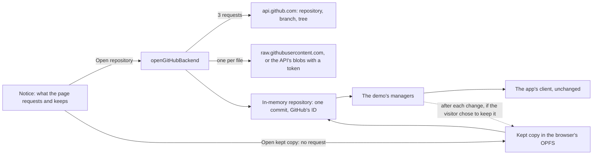

# GitHub

**Genbeya on GitHub** opens a repository on github.com in a browser tab, with its wiki, its task board and the code they refer to, without cloning it: `genbeya.fyi/github/<owner>/<repo>`, or `…/tree/<branch>` for a branch, the way GitHub spells it. Replacing `github.com` with `genbeya.fyi/github` in a repository's address opens it in Genbeya. References render exactly as in the app, because it is the app's client, engines and the [Demo](Demo.md)'s managers.

> [!NOTE]
> This is the proof of concept of [[GENBEYA-39]] and [[GENBEYA-40]]: nothing is written back to GitHub, public repositories open without signing in, private ones with a token, and a repository is kept in the browser only when the visitor chooses so. It is not yet served by genbeya.fyi; see [Hosting](#hosting) and [Next steps](#next-steps).

[TOC]

## How it works



| Part | Where | What it does |
| --- | --- | --- |
| Build | `angular.json` configuration `github` | Like the demo's, with `connect.github.ts` and `index.github.html`, whose content security policy also allows connections to `api.github.com` and `raw.githubusercontent.com`; writes `dist/github/browser` |
| Address | `src/utilities/github-address.ts` | `/github/<owner>/<repo>[/tree/<branch>]`, or `?repo=<owner>/<repo>&branch=<branch>` wherever the page is served; GitHub's rules for names, Git's for branches |
| Start screen | `src/client/app/platform/github-notice.ts` | The notice, the choices, the progress and the errors, in plain DOM before the client starts |
| Connector | `src/client/app/platform/github-connector.ts` | Composes the start screen, the keeper and the backend; saves after each change while the repository is kept, one tab at a time; the badge's words and choices (**GitHub** · owner/repo, **Open on GitHub**, **Keep in this browser**, **Delete the kept copy**) |
| Keeper | `src/managers/demo/github-keeping.ts` | Kept repositories: a summary to list each by, and its whole state (`src/access/memory/repository-state.ts`) |
| Kept files | `src/access/browser/kept-files.ts` | The browser's Origin Private File System (OPFS), or a `Map` in tests |
| Backend | `src/managers/demo/github-backend.ts` | Chooses what to read, builds the in-memory repository, and runs the demo's managers on it; fetching and pushing are refused |
| Reader | `src/access/github/github-reader.ts` | GitHub's REST API and raw files, with errors a visitor can act on; `fetch` is injected |
| Simulated GitHub | `src/testing/fake-github.ts` | The endpoints the reader uses, for the unit tests and `e2e/github/` |

The repository becomes one commit, the one the branch points to, under GitHub's own commit ID, so **Copy web link** and links to commits lead to the same place on github.com. `origin` is the repository's clone URL, and the branch tracks it, up to date. Edits, commits, branches and the rest work as in the demo, in memory; **Fetch**, **Pull** and **Push** say that Genbeya on GitHub doesn't fetch or push yet.

## What it reads

Opening a repository costs three API requests: the repository (default branch, privacy, clone URL), the commit of the branch, and its whole tree (`git/trees/<sha>?recursive=1`). Then it reads Genbeya's content, not the whole repository:

1. `.genbeya.yml`, which says where the wiki and the tasks are;
2. everything below the wiki and task folders, and every Markdown file (READMEs, `AGENTS.md`);
3. the files those name: `[[path]]` references and `![[path#L1-L9]]` embeds, and relative Markdown links and images.

Everything else stays on GitHub; the badge says how many files. At most 3000 files and 30 MB are read, and no file over 1 MB; symbolic links and submodules are left out.

> [!IMPORTANT]
> Reading every file does not scale. The first version did: Genbeya's own repository is 706 files and 4.8 MB, which loaded in 13 seconds, and loading it twice within a few minutes made raw.githubusercontent.com answer *429 Too Many Requests*. Reading the content only, the same repository is 85 files, in about 3 seconds.

Without a token, files come from `raw.githubusercontent.com/<owner>/<repo>/<commit>/<path>`, which allows any origin and doesn't count against the API's limit. With a token, they come from the API's blobs (`git/blobs/<sha>` with `Accept: application/vnd.github.raw+json`), one request per file.

## What GitHub allows from a web page

Probed on 2026-11-09 with requests from the origin `https://genbeya.fyi`:

| Endpoint | From a web page | Used for |
| --- | --- | --- |
| `api.github.com` (REST) | Yes: `Access-Control-Allow-Origin: *`, rate limit headers exposed | Repository, branch, tree; blobs with a token |
| `raw.githubusercontent.com` | Yes: `Access-Control-Allow-Origin: *`; cached for 5 minutes; limits how fast one client reads | Files without a token |
| `codeload.github.com` (tarballs) | No: only `render.githubusercontent.com` may read them | — |
| `github.com/login/oauth/access_token`, `github.com/login/device/code` | No: no CORS headers at all | Signing in needs a relay, see below |
| `api.github.com/graphql` | Documented to; couldn't be probed from the development environment | Later: many files in one request |

Requests without a token carry no headers of their own, so browsers send them without a preflight. Requests with a token send `Authorization`, which needs one; GitHub's API answers preflights, but this was not verified from a real browser yet.

Rate limits: without signing in, the API allows 60 requests an hour per IP address, which is 20 repositories opened; with a token, 5000, which is the number of files read too.

## Privacy

Genbeya's promise is privacy first: nothing is collected or sold, and everything that leaves the device or stays on it is the visitor's choice. Genbeya on GitHub keeps that promise by design, not by policy alone: [[GENBEYA-43]] is the outside review of what follows.

### The notice

Every address of the page starts at the notice, and nothing is requested before the visitor chooses **Open repository**: the end-to-end tests open the page at every kind of address (with a branch, with a view in the hash, with `?repo=`) and check that nothing reached GitHub and none of the app ran. **Cancel** sends nothing and keeps nothing. The notice says, before anything happens:

- that the browser asks GitHub for the files, at `api.github.com` and `raw.githubusercontent.com`;
- that GitHub sees the visitor's IP address and that the requests come from a page on genbeya.fyi. Browsers send an `Origin` header with every cross-origin request, and no page can suppress it; the page itself sends no referrer;
- that GitHub processes the requests under its privacy statement, linked, also in the United States;
- that nothing goes anywhere else, nothing tracks the visitor, and nothing is written back to GitHub;
- what keeping the repository means, in its own choice, off by default.

### What leaves the device

| To | What | When |
| --- | --- | --- |
| GitHub | Requests for the repository and its files: IP address, `Origin: https://genbeya.fyi`, the browser's own headers; with a token, the token | After the visitor chose **Open repository** or **Read again from GitHub** |
| genbeya.fyi (its host) | Requests for the page's own files, which the hosting provider logs as for any website | When the page loads |
| Anyone else | Nothing: the content security policy allows connections only to the page's origin and the two GitHub hosts | Never |

The repository's content, which holds personal data such as commit authors, never reaches genbeya.fyi: it is processed in the visitor's browser, as by desktop software.

### What stays on the device

Nothing, unless the visitor chooses to keep the repository: no cookies, no local storage, no IndexedDB, and the tests check it. A kept repository lives in OPFS, see [Keeping a repository](#keeping-a-repository). Tokens are never kept: they are used while the files are read and then dropped; the managers that run afterwards never get them.

### Security

Repository content is shown by the same client, so [Security](Security.md) applies unchanged: Markdown through the allowlist, diagrams as images, remote images never loaded. Paths from GitHub's tree pass the repository path rules, and names and branches are checked before any request.

## Keeping a repository

**Keep it in this browser** is a choice of its own on the notice, never ticked in advance, and **Keep in this browser** in the badge's menu asks first too. While it is on:

- The whole repository is saved to the browser's Origin Private File System (OPFS), a folder only pages of the site can reach: its commits, index, working tree, branches, tags, remote-tracking branches, stashes, conflicts and an operation in progress (`repository-state.ts`). Each file's content is saved once, however many commits hold it.
- Saving follows every call that changes something, a moment later, and when the page is hidden. A save writes nothing when nothing changed, and replaces the files at once: a write that fails leaves the last saved state.
- The page asks the browser not to evict kept files when space runs low (`navigator.storage.persist()`).
- One tab at a time keeps a repository (a Web Lock named after it); another tab can still open it without keeping it.

The next visit to the repository's address shows the kept copy on the notice: **Open kept copy** opens it as it was saved and asks nothing of GitHub. **Read again from GitHub** reads the repository afresh; ticked, keeping it replaces the kept copy.

Deleting is as easy as keeping: **Delete kept copy** on the notice, **Delete the kept copy** in the badge's menu (the repository stays open in the tab), and **Delete everything kept** at the foot of the notice and the start page, which also says how much the browser keeps.

> [!NOTE]
> OPFS belongs to the origin, here every page of genbeya.fyi. Serving Genbeya on GitHub from an origin of its own keeps what it stores apart from the rest of the site ([[GENBEYA-41]]).

## Hosting

The page's files use relative addresses, and its policy forbids `<base>`. Since the page is served at addresses of any depth (`/github/acme/rockets/tree/feature/x`), the files live in one folder and the page's own references are made absolute: `scripts/serve-github.mjs` serves the build below `/github/_app/` and the page for every other address below `/github/`. No owner on GitHub can be called `_app`. PlantUML's wasm is resolved next to the scripts (`new URL("rockuml.wasm", import.meta.url)`), so it is found at any depth too.

genbeya.fyi will do the same ([[GENBEYA-41]]), on an origin of its own such as `open.genbeya.fyi`, with `genbeya.fyi/github/…` redirecting there. Browser storage and the content security policy belong to an origin: on its own origin, what Genbeya on GitHub keeps can't be read by the rest of the site, and genbeya.fyi's promise (no request to another origin, nothing stored) stays literally true for every other page.

### The badge

A README links its repository on genbeya.fyi with the static badge [`branding/open-in-genbeya.svg`](../../branding/open-in-genbeya.svg):

```markdown
[](https://genbeya.fyi/github/<owner>/<repo>)
```

GitHub shows README images through its own image proxy, so readers' addresses don't reach genbeya.fyi. The badge is one file for every repository and must stay so: a badge made per repository would tell the server who reads which README, like a tracking pixel.

## Other forges

Everything above the reader is forge-neutral, so `/gitlab/<owner>/<repo>`, `/bitbucket/…` and `/gitea/…` need a reader each behind one interface ([[GENBEYA-42]]). Probed on 2026-11-09 from the origin `https://genbeya.fyi`:

| Forge | From a web page | Unlike GitHub |
| --- | --- | --- |
| gitlab.com | API: yes. `/-/raw/` files: no | The tree comes in pages of 100; raw files through the API |
| Bitbucket Cloud | API: yes | Folder listings come in pages, with no one request for the whole tree; Bitbucket Data Center has another API |
| Codeberg (Forgejo) | API: yes | Its API mirrors GitHub's, including the whole tree in one request |
| Self-hosted Gitea and Forgejo | Only when the instance enables CORS (`[cors] ENABLED=false` by default) | |
| Git itself (`info/refs` on github.com and gitlab.com) | No | Why there is no Git in the page, see below |

Self-hosted instances would be named with `?host=`. The browser makes the requests, so an instance reachable only over a VPN works, and genbeya.fyi never sees it. The policy then allows exactly that host, set per request by the Worker, and the notice and the token field show the host prominently: otherwise a link naming a host of an attacker's could ask a visitor for their token.

### Why the forge's API and not Git

Git's own protocol endpoints answer no other origin, so Git in the page (compiled to WebAssembly, or isomorphic-git) could only clone through a proxy that adds the headers: a third party that sees every request, tokens included, and a clone of the whole history up front. The forges' APIs answer web pages and let the page read only the files it needs. History and writing back go through them too: commits from the commits API, edits as commits made through the API.


## Options considered

| Option | Verdict |
| --- | --- |
| **The web client on GitHub's API** (this page) | Chosen: the board, the wiki and references as in the app, private repositories included, no server of our own except, later, a sign-in relay |
| A GitHub Action that publishes the wiki and the board to Pages | Cheap and needs no sign-in, but read-only and, on most plans, public even for private repositories; worth it later for open-source projects |
| Mirroring to GitHub's Wiki and Projects | Only one way, if at all: GitHub's wiki is a flat set of pages with its own `[[…]]` syntax (link text first) and no embeds, and Projects would need a second source of truth for status, comments and people |
| A browser extension | The only way to render references inside github.com's own pages; it breaks whenever GitHub changes its markup. A later add-on, not the foundation |

## Limitations

- **History** is one commit: task activity shows the task as it is, and **History** shows only the branch's last commit.
- **Code** has only the files the wiki and tasks refer to.
- **Nothing is written back** to GitHub; fetching and pushing are refused, also for a kept copy, which stays as it was read until it is read again.
- Files in **Git LFS** show their pointer text.
- **Content branch**: a repository that keeps its wiki or tasks on a content branch shows what its checkout has.

## Next steps

- Sign in with a GitHub App instead of pasting a token. GitHub's token endpoints refuse web pages, so the code exchange needs a small stateless relay; the website already runs as a Cloudflare Worker.
- Serve it from genbeya.fyi, on an origin of its own, with the badge ([[GENBEYA-41]]), after the privacy review ([[GENBEYA-43]]).
- Other forges, also self-hosted ([[GENBEYA-42]]).
- Fetch into a kept copy: what changed on GitHub since, merged with the visitor's changes, which the in-memory repository can already merge.
- Write back: commit edits through the API (one commit per save, or a branch and a pull request).
- History and task activity from GitHub's commits; the content branch; GraphQL to read many files per request; reading other files when they are opened.
