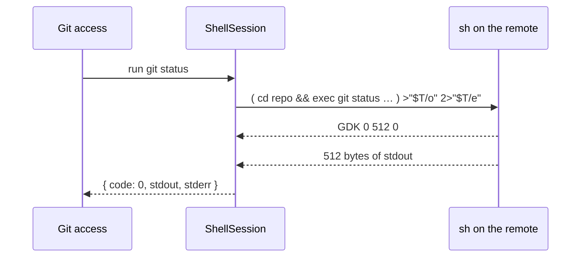

# Hosts

A host is the machine a repository lives on. Resource access only uses the `Host` interface (`src/access/hosts/host.ts`): run a command, read, write, move and delete files.

| Host | Implementation |
| --- | --- |
| Local | `LocalHost` — the platform's file system and processes |
| WSL | `ShellHost` over `wsl.exe -d <distro> -e sh` |
| SSH | `ShellHost` over `ssh -T -o BatchMode=yes <host> sh` |

## Terminals

Each host also says how to start an interactive shell in a repository (`terminalCommand`, built in `src/access/hosts/terminal-commands.ts`). The shell runs on a pseudo-terminal of this machine:

| Host | Command |
| --- | --- |
| Local | The user's shell in the repository folder: `pwsh.exe -NoLogo`, `powershell.exe -NoLogo` or `COMSPEC` on Windows, `$SHELL -l` or `/bin/sh -l` elsewhere |
| WSL | `wsl.exe -d <distro> --cd <path>` |
| SSH | `ssh -t -- <host>` with the remote command `cd '<path>' && exec "$SHELL" -l`, the path quoted for `sh` |

Unlike the backend's own connection, the terminal's `ssh` runs without `BatchMode`, so the user can answer password and host key prompts.

## The shell session

WSL and SSH share one implementation. `ShellSession` keeps a single `sh` running on the target and sends each request as a subshell script. Output goes to temporary files and comes back with a length-prefixed header, so binary content is safe and one connection serves all requests.

File content is written with `printf` and octal escapes, which only needs a POSIX shell — no extra tools on the remote. Requirements on the remote: `sh`, `git`, and the usual `cat`, `wc`, `mktemp`, `mkdir`, `mv`, `rm`.

> [!IMPORTANT]
> The login shell of the SSH user must accept a POSIX command line (bash, zsh, dash, ksh). See GENBEYA-9 for fish and other shells.
