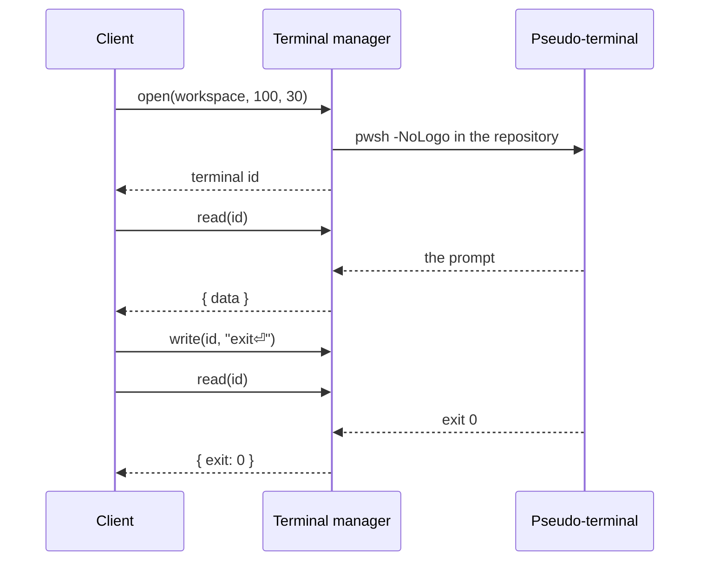

# Managers

Four managers implement everything the client can do with a repository. Their contracts are in `src/contracts/manager-contracts.ts`; `src/managers/backend.ts` composes them for a shell.

| Manager | Use cases |
| --- | --- |
| `workspace` | Open, clone, restore and close repositories; create the sample repository; snapshots; recent repositories; app preferences; browsing folders on WSL and SSH |
| `content` | Files, wiki pages, tasks and their templates, `.gitdesk.yml`, the [[Content branch]], full-text [[Search]], and the files that teach [[AI agents]] to use them |
| `versionControl` | Diffs, staging, commits, branches, remotes, fetch/pull/push, history |
| `terminal` | Shells in the repository for the [[Terminal]]: open, input, size, output, close |

Every call names the workspace it was made for (or a terminal, which belongs to one), so a call racing a repository switch fails instead of touching the new repository. Every argument is validated again in the manager, so managers can sit directly behind IPC.

## Calls

The client sends `{ manager, method, args }` and receives `{ ok: true, value }` or `{ ok: false, message }` (`src/contracts/rpc.ts`). `MANAGER_METHODS` lists the methods a shell may dispatch; the compiler checks that it matches the contracts.

## Snapshots

The client asks for `snapshot(workspace, since)` every four seconds and whenever the window regains focus. A snapshot holds branch state, changes, the file tree, the wiki tree, all tasks and settings. `since` is the version the client already has; when nothing changed the manager answers `null` and nothing is sent.

One snapshot costs a handful of Git calls:

- `git status --porcelain=v2 --branch` for branch, upstream, ahead/behind and changes
- `git ls-files` for the tree, which also hides everything `.gitignore` excludes
- `for-each-ref` and `remote -v` for branches and remotes
- a single batched read for all task files

## Task comments and activity

Comments live at the end of the task file (format in [[Tasks#comments]]); `Task.body` is the description above them and `Task.comments` the comments, oldest first. The task engine splits and joins the two, so `updateTask` keeps the comments as written and the comment calls keep the frontmatter and description as written.

- `addComment(workspace, path, text)` appends a comment to the file as it is now; it needs no version, since comments only ever go last.
- `editComment` and `deleteComment` name the comment by its index in the version `expectedHash`, and only change comments signed with the user's name.
- `commentAuthor(workspace)` is that name: `git var GIT_AUTHOR_IDENT`, which is `user.name` or what Git derives from the system account. Without one, comment calls ask the user to set `user.name`.

`taskActivity(workspace, path)` reads the history of the task file wherever it lives — the checkout, or the worktree of the [[Content branch]] — with one call:

```
git log --follow --no-merges --max-count=100 --patch --unified=1000000 -- <path>
```

The patches carry whole files, so every commit yields both versions, and `rename from`/`rename to` lines give the path before and after; the task engine compares the two versions (status, priority, assignee, title, epic, labels, description, comments, other frontmatter fields). Task files over 256 KiB are listed without patch context, so the output stays small. Edits not committed yet come first, as an entry without commit; a task moved to another epic since the last commit is found under its committed path by its file name.

## Preferences

`workspace.preferences()` and `setPreferences(change)` keep the user's preferences in `state.json` in the app's data folder, next to the recent repositories, so they survive reinstalling the same variant. Besides theme and startup they remember the onboarding: the version whose news the user has seen (`null` before the first start; state saved by versions that did not remember it counts as `0.0.0`, so its user sees all news), whether the tour was taken, and the repositories that offered it.

## Sample repository

`workspace.createSample(parent)` creates `gitdesk-sample` (or `gitdesk-sample-2`, …) below `parent` on its host, so it works locally, on WSL and over SSH, and opens it. The sample engine (`src/engines/sample-engine.ts`) holds the files and the commits that create them; the last step stays uncommitted, so **Changes** has something to show. The commits are made as *GitDesk*, without signing: the user's identity may not be set up yet.

## Remote folders

`workspace.browse({ kind, distro | host, path })` lists the subfolders of a folder on WSL or SSH, for the folder browser of the open and clone dialogs. An empty path, `~` or `~/…` starts in the home folder. The listing has the folder's absolute path (links resolved), its parent (null at `/`) and up to 2000 subfolders, sorted by name ignoring case with hidden ones last; each says whether it is a Git repository (holds `.git`), and `truncated` says when there were more. Folders on this computer use the system folder dialog instead.

Connection failures name the machine: `Can't connect to <host>: <ssh's reason>`, or `WSL has no distribution named <distro>.` See [[Hosts]] for how one listing travels.

## Search

`content.search(workspace, text, { caseSensitive, wholeWord, regex })` finds text in pages, tasks and code and answers `{ wiki, tasks, code, truncated }`: per file its path, scope and title (a task also its ID and status), and per match the line number, the line, where the text matches in it, and the lines before and after. Text is literal and case is ignored unless the options say otherwise; regular expressions are POSIX extended ones.

It runs `git grep` on the repository's host, so it needs nothing but Git there, in two calls per working tree:

1. `git grep -l -z -I --untracked` lists the files with a match: tracked ones and untracked ones that `.gitignore` does not exclude, binary files skipped. The search engine (`src/engines/search-engine.ts`) sorts them into areas — Markdown below the task folder is a task, below the wiki folder a page, everything else code — and keeps 30 per area.
2. `git grep -n --column -z -C1` on just those files returns the matching lines and one line of context. With `-z`, paths end at a NUL, and only matches carry a column, which tells them from context lines whatever the text holds.

The engine then finds the matches within each line (for highlighting), keeps 10 per file, and shortens lines over 200 characters around the first match. `truncated` says whether anything was left out. With a [[Content branch]], the content worktree supplies pages and tasks and the checkout only code, so stale copies in the checkout are not listed twice.

The text travels as the argument of `-e`, after `-F` or `-E`, in an argument list: never through a shell string, never readable as an option. The manager rejects empty or blank text, more than 200 characters, line breaks (git would read several patterns) and options that are not booleans. A search that runs longer than 20 seconds is stopped.

## Terminals

`terminal.open(workspace, cols, rows)` asks the repository's host how to start a shell in its root (`src/access/hosts/terminal-commands.ts`) and starts it on a pseudo-terminal of the machine port; WSL and SSH shells run through `wsl.exe` and `ssh` on that terminal. Terminals belong to their workspace: they end when it closes, and when the app quits.

Shells only answer requests, so output reaches the client by long polling. `read(terminal)` returns everything printed since the last read as soon as there is some, an empty string after 25 seconds without output, and the exit code once the shell ended and its output was read. The client reads in a loop, which streams over every shell's bridge. Unread output is capped at a million characters; older output is dropped. Input is sent in order, batched while a write is under way.



## Writes

Saves carry the hash of the content they were based on. If the file changed on disk since, the save is rejected and the editor keeps the draft. Line endings and a byte order mark are kept as they were. All operations on one workspace run one at a time.

Structured files change only where they must. A task update rewrites the fields GitDesk manages and the custom fields it names, and leaves the type alone unless it names one; saving settings rewrites only the keys of `.gitdesk.yml` whose values changed. Comments, unknown keys and the spelling of everything else survive. New tasks of a type start from `<taskRoot>/.templates/<type>.md` (`content.taskTemplate`), which the settings create on first use (`content.ensureTaskTemplate`).

## Moving pages

`content.movePage(workspace, from, to, { updateLinks })` moves a page with its subpage folder. With `updateLinks`, it reads every Markdown file of the content location (in the checkout, that includes `README.md` and other documentation) in one batch, and the link engine (`src/engines/link-engine.ts`) rewrites what the move would break:

- relative Markdown links and definitions (`[x](../Guide/Wiki.md#part)`, `[x]: Guide.md`) and images that point into the moved pages, from anywhere;
- relative links inside the moved pages that point out of them;
- `[[references]]` to moved pages by path (`[[Guide/Wiki]]`, `[[docs/Guide/Wiki.md]]`), and by title when the title changes; to files in a moved folder by path.

The engine parses with the same Markdown parser as the client, so code blocks and inline code stay untouched, and resolves references by the rules the client renders them with (`src/utilities/references.ts`). Only destinations and reference targets change, written in the style they had: relative or from the root, title or path, with or without `.md`, percent-encoded or in `<…>`. A new title that another page also has is written as a path. The moves and the rewritten files are committed together, so on a [[Content branch]] the move is one commit.

`content.pageLinks(workspace, from, to)` returns the same changes without making them, per file with line, before and after, for the move dialog.

## Paths

Repository paths from the client are validated in `src/utilities/repository-path.ts`: no absolute paths, no `..`, nothing inside `.git` (including Windows aliases such as `.git.` and `GIT~1`). Hosts refuse to follow symbolic links below the repository root. Git runs with `--literal-pathspecs`, so file names are never globs.
