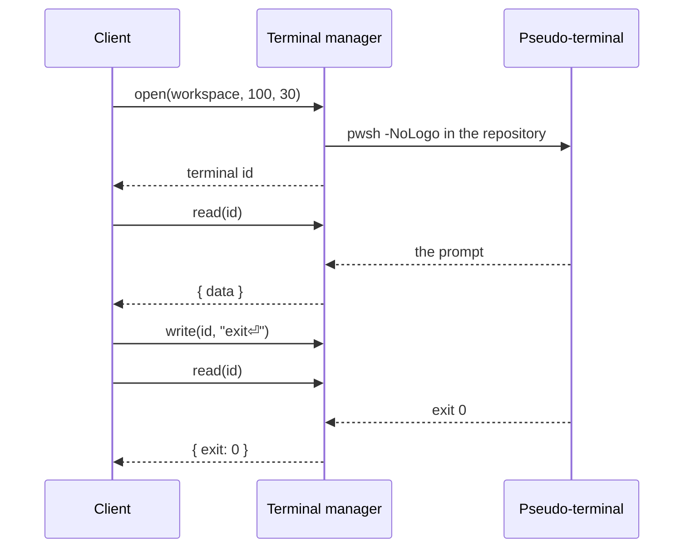

# Managers

Four managers implement everything the client can do with a repository. Their contracts are in `src/contracts/manager-contracts.ts`; `src/managers/backend.ts` composes them for a shell.

| Manager | Use cases |
| --- | --- |
| `workspace` | Open, clone, restore and close repositories; snapshots; recent repositories; app preferences |
| `content` | Files, wiki pages, tasks, `.gitdesk.yml`, and the [[Content branch]] |
| `versionControl` | Diffs, staging, commits, branches, remotes, fetch/pull/push, history |
| `terminal` | Shells in the repository for the [[Terminal]]: open, input, size, output, close |

Every call names the workspace it was made for (or a terminal, which belongs to one), so a call racing a repository switch fails instead of touching the new repository. Every argument is validated again in the manager, so managers can sit directly behind IPC.

## Calls

The client sends `{ manager, method, args }` and receives `{ ok: true, value }` or `{ ok: false, message }` (`src/contracts/rpc.ts`). `MANAGER_METHODS` lists the methods a shell may dispatch; the compiler checks that it matches the contracts.

## Snapshots

The client asks for `snapshot(workspace, since)` every four seconds and whenever the window regains focus. A snapshot holds branch state, changes, the file tree, the wiki tree, all tasks and settings. `since` is the version the client already has; when nothing changed the manager answers `null` and nothing is sent.

One snapshot costs a handful of Git calls:

- `git status --porcelain=v2 --branch` for branch, upstream, ahead/behind and changes
- `git ls-files` for the tree, which also hides everything `.gitignore` excludes
- `for-each-ref` and `remote -v` for branches and remotes
- a single batched read for all task files

## Terminals

`terminal.open(workspace, cols, rows)` asks the repository's host how to start a shell in its root (`src/access/hosts/terminal-commands.ts`) and starts it on a pseudo-terminal of the machine port; WSL and SSH shells run through `wsl.exe` and `ssh` on that terminal. Terminals belong to their workspace: they end when it closes, and when the app quits.

Shells only answer requests, so output reaches the client by long polling. `read(terminal)` returns everything printed since the last read as soon as there is some, an empty string after 25 seconds without output, and the exit code once the shell ended and its output was read. The client reads in a loop, which streams over every shell's bridge. Unread output is capped at a million characters; older output is dropped. Input is sent in order, batched while a write is under way.

## Writes

Saves carry the hash of the content they were based on. If the file changed on disk since, the save is rejected and the editor keeps the draft. Line endings and a byte order mark are kept as they were. All operations on one workspace run one at a time.

## Paths

Repository paths from the client are validated in `src/utilities/repository-path.ts`: no absolute paths, no `..`, nothing inside `.git` (including Windows aliases such as `.git.` and `GIT~1`). Hosts refuse to follow symbolic links below the repository root. Git runs with `--literal-pathspecs`, so file names are never globs.
