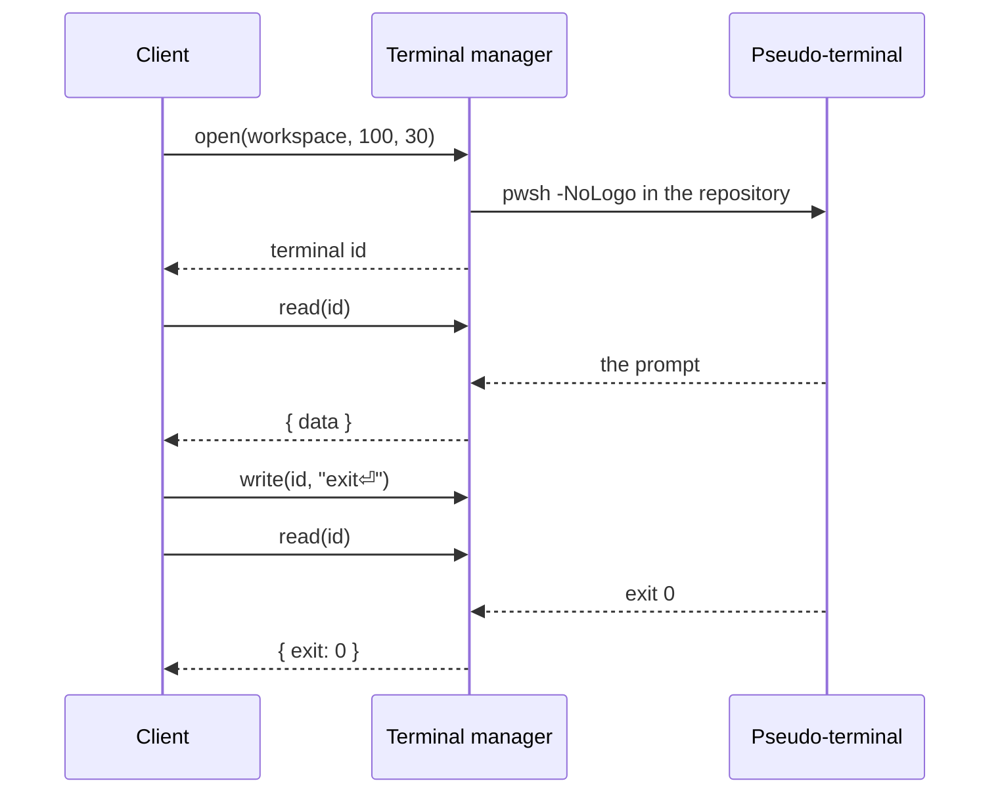

# Managers

Four managers implement everything the client can do with a repository. Their contracts are in `src/contracts/manager-contracts.ts`; `src/managers/backend.ts` composes them for a shell.

| Manager | Use cases |
| --- | --- |
| `workspace` | Open, clone, restore and close repositories; create the sample repository; snapshots; recent repositories; app preferences; browsing folders on WSL and SSH |
| `content` | Files, wiki pages, tasks and their templates, `.genbeya.yml`, where each of those areas lives (the [Content branch](Content-branch.md)), full-text [Search](../Guide/Search.md), the repository's people, and the files that teach [AI agents](../Guide/AI-agents.md) to use them |
| `versionControl` | Diffs, staging whole files or hunks and lines, .gitignore rules, commits, stashes, branches, tags, remotes, fetch/pull/push, pushing anywhere and force pushing, history, merges, rebases, resets and conflicts |
| `terminal` | Shells in the repository for the [Terminal](../Guide/Terminal.md): open, input, size, output, close |

Every call names the workspace it was made for (or a terminal, which belongs to one), so a call racing a repository switch fails instead of touching the new repository. Every argument is validated again in the manager, so managers can sit directly behind IPC.

## Calls

The client sends `{ manager, method, args }` and receives `{ ok: true, value }` or `{ ok: false, message }` (`src/contracts/rpc.ts`). `MANAGER_METHODS` lists the methods a shell may dispatch; the compiler checks that it matches the contracts.

## Snapshots

The client asks for `snapshot(workspace, since)` every four seconds and whenever the window regains focus. A snapshot holds branch state, changes (conflicted ones say how they conflict), tags, stashes, the merge, rebase, cherry-pick or revert in progress, the file tree, the wiki tree, all tasks and settings. `since` is the version the client already has; when nothing changed the manager answers `null` and nothing is sent.

One snapshot costs a handful of Git calls:

- `git status --porcelain=v2 --branch` for branch, upstream, ahead/behind, changes and conflicts
- `git ls-files` for the tree, which also hides everything `.gitignore` excludes
- `for-each-ref` and `remote -v` for branches, tags and remotes
- `stash list` for the stashes
- a single batched read for all task files
- a single batched read of `MERGE_HEAD`, `rebase-merge/…` and their kind in the git directory for the operation in progress (and, during a rebase, a `for-each-ref` to name what it goes onto)

`snapshot(workspace, since, base)` takes what staged changes are compared with: `"head"` (the default) or, while the last commit is being amended, `"parent"`. Then the index letters of the changes come from `git diff --cached --name-status -M <parent>` instead of `git status` — the first parent of HEAD, or the empty tree for a first commit — so the staged list holds what the amended commit will; working-tree letters stay as `git status` has them. The snapshot then also has `amending`: the commit, its parent, whether it is a merge (`git commit --amend` keeps all parents) and the remote branches that contain it, for a warning that amending means force-pushing. Before the first commit there is nothing to amend and the base is ignored. The base is part of what the version covers.

## Staging parts of files

`diff(path, source, oldPath, base)` returns both sides of a file and their `version`, a hash of the two and of the diff options below. For the working tree and the index it also returns `changes`: the runs of changed lines of Git's diff of the file — the diff staging patches — so the client shows each change where Git has it. With repeated lines (braces, blank lines) diff algorithms may place a change differently, and CodeMirror's would otherwise pick other line numbers than the patch has. The manager checks that Git's diff turns the one side into the other (carriage returns at line ends aside, which Git converts) and leaves `changes` out when it does not, e.g. for a file Git shows only as a whole; the client then offers no line actions. An untracked file is all new.

`stageLines`, `unstageLines` and `discardLines` take a `LinePatch`: the path (and the old path of a staged rename), that version, and the chosen lines — removed lines by their number in the original, added lines by their number in the modified version. The manager reads the sides again and refuses lines chosen in a diff that changed meanwhile, or in a binary or oversized file.

Then it asks Git for its own diff of the file (`git diff` of the working tree, or `git diff --cached -M <base>` of the index, with fixed `a/` and `b/` prefixes, no external diff, no text conversion, and the Myers algorithm with the indent heuristic and no merged hunks, whatever the user's configuration says) and the patch engine (`src/engines/patch-engine.ts`) keeps only the chosen changes:

- Staging applies the patch forward with `git apply --cached`; unchosen removals become context and unchosen additions are left out. Unstaging (`git apply --cached --reverse`) and discarding (`git apply --reverse` on the working tree) work the other way round.
- Within a run of changed lines, the n-th removal and the n-th addition belong together, so a removal kept as context goes where its replacement would have gone.
- Hunk headers are counted anew, and the start of each hunk follows what the hunks before it now add. Lines keep their carriage returns, and a line that ends the file without a newline gets one when lines now follow it.
- A partly chosen creation or deletion becomes a change of the file; a renamed file is patched under the name the patch applies to, so the rename stays.

The patch goes into `genbeya.patch` in the git directory, since hosts give processes no standard input, and runs with `--no-ignore-whitespace --recount --whitespace=nowarn`; Git applies it only where the context matches exactly. Lines of an untracked file are staged after `git add --intent-to-add`, which is undone when applying fails; discarding lines of one leaves the rest untracked. `unstage(paths, "parent")` resets the paths (and the old side of renames) to their version in HEAD's parent with `git reset -q <parent> -- <paths>`, which leaves them out of the amended commit.

## .gitignore

`ignore(path, kind, location)` adds a rule to the `.gitignore` in the folder `location` ("" for the root), which must hold `path`. `src/utilities/gitignore.ts` writes the rule — `/path` for a file, `/path/` for a folder, `*.ext` for an extension — relative to that folder, escapes `\`, `*`, `?`, `[` and trailing spaces, and appends it in the file's line endings, ending with one, unless the file has it already. The client uses the same utility for its preview. `untrack(paths)` runs `git rm --cached -r` and keeps the files.

## Operations that stop

Merging, rebasing, cherry-picking, reverting and applying a stash can stop for conflicts. These calls resolve to `"done"`, or to `"stopped"` when Git left conflicts or an operation in progress; the snapshot then shows the operation and the conflicted files, and `continueOperation`, `skipOperation` and `abortOperation` go on with whatever is in progress — the manager reads which operation that is, the client does not say. `continueOperation` refuses while conflicts are left. A failure that leaves nothing to resolve (local changes in the way, say) is an error as usual.

`conflict(path)` returns a conflicted file's text with its markers (null for binary, missing or oversized files); `resolveConflict` takes one side (`git checkout --ours/--theirs`, or `git rm` when that side deleted the file), keeps the working-tree file, deletes the file, or writes new text — and stages the result. Conflict markers, including the diff3 style, are parsed in `src/utilities/conflict-markers.ts`, which the client uses for its hunk buttons.

Git never opens an editor for Genbeya: every call runs with `GIT_EDITOR=:`, which makes Git keep the message it prepared, as for `merge --continue`.

Rewriting history needs a clean working tree: `rebase`, `pullRebase` and `rebaseInteractive` refuse uncommitted changes to tracked files unless `autostash` is set, which passes `--autostash`. `rebasePlan(base)` lists the commits a rebase would rewrite and the remote branches that already have them, so the client can warn before anyone has to force-push. Merge commits are not cherry-picked, reverted or rebased interactively.

### Resets

`resetPlan(hash)` says what resetting the current branch to a commit would do: the commits that leave it, how many of them its upstream has (they come back as behind), the tracked files with uncommitted changes, which a hard reset discards, and the untracked and ignored files the commit has and HEAD has not (`git diff --diff-filter=A HEAD <commit>`, then `git ls-files --others`), which hard and keep resets overwrite. Its `state` fingerprints all of that: the staged changes (`git diff --cached --raw`), the unstaged ones (`git diff --binary`) and the content of those files. `reset(hash, mode, expectedHead, expectedState)` runs `git reset --soft|--mixed|--hard|--keep` only while HEAD is still at `expectedHead`, the commit the plan was made at, and a hard or keep reset only while the state is still `expectedState`, so changes made while the user looked at the plan are never lost unseen; it resolves to `{ from, to }`; undoing is a reset back to `from` expecting `to`. `undoLastCommit(expectedHead)` is a soft reset to the parent of HEAD, refused once HEAD moved from the commit shown (a short id will do), for the first commit and for merges. All three refuse while an operation is in progress or files are conflicted, like the operations above: aborting one afterwards would go back to before the reset.


The client sends every commit after `base` once, in the new order, each with an action and, for reword and squash, a message. `src/engines/rebase-engine.ts` checks the steps against the commits and turns them into a todo list that needs no editor: squashes become `fixup`, and a commit whose message changes is followed by `exec git commit --amend --file=<message>`. Git access writes the todo list and the messages into `genbeya-rebase/` in the git directory and runs `git rebase -i` with `GIT_SEQUENCE_EDITOR="cat '<todo>' >"`: Git runs editors and `exec` lines through its own `sh`, so the same commands work on Windows (Git for Windows' sh), WSL and SSH hosts. Shell hosts pass environment variables by exporting them in the request's subshell.

## Pushing

`sync(push)` pushes the current branch to its upstream, or publishes it with `--set-upstream`. `push(request)` pushes any local branch to a branch of any name on a remote, with the refspec `refs/heads/<local>:refs/heads/<remote>` after `--end-of-options`, and sets the upstream when asked. It resolves to `"rejected"` when the remote branch has commits the local one lacks (git's `non-fast-forward` or `fetch first`), so the client can offer a force push; other failures are errors. `pushPlan(branch)` lists the upstream and, per remote, its branches as last fetched and its default branch: `refs/remotes/<remote>/HEAD` when a clone or `remote set-head` recorded it, else `git ls-remote --symref` asks the remote.

A force push never goes without a lease. `forcePushPlan(branch, remote, remoteBranch)` names the commit of the remote-tracking branch and lists the commits on it the local branch lacks — what others lose. The client shows them and sends that commit back as `force.expected`; the push runs with `--force-with-lease=refs/heads/<remote>:<expected>` (empty when the branch did not exist), so a fetch between the plan and the push cannot move what the lease expects, plus `--force-if-includes` when `git version` is 2.30 or newer (`Git.supports`). A lease that no longer holds (`stale info`) fails with *origin/main changed since your last fetch. Fetch and review it first.* Force pushing to the remote's default branch — main or master while it is unknown — is refused unless `force.defaultBranch` is set.

## Task comments and activity

Comments live at the end of the task file (format in [Tasks](../Guide/Tasks.md#comments)); `Task.body` is the description above them and `Task.comments` the comments, oldest first. The task engine splits and joins the two, so `updateTask` keeps the comments as written and the comment calls keep the frontmatter and description as written.

- `addComment(workspace, path, text)` appends a comment to the file as it is now; it needs no version, since comments only ever go last.
- `editComment` and `deleteComment` name the comment by its index in the version `expectedHash`, and only change comments signed with the user's name.
- `commentAuthor(workspace)` is that name: `git var GIT_AUTHOR_IDENT`, which is `user.name` or what Git derives from the system account. Without one, comment calls ask the user to set `user.name`.

`taskActivity(workspace, path)` reads the history of the task file wherever it lives — the checkout, or the worktree of the [Content branch](Content-branch.md) — with one call:

```
git log --follow --no-merges --max-count=100 --patch --unified=1000000 -- <path>
```

The patches carry whole files, so every commit yields both versions, and `rename from`/`rename to` lines give the path before and after; the task engine compares the two versions (status, priority, assignee, title, epic, labels, description, comments, other frontmatter fields). Task files over 256 KiB are listed without patch context, so the output stays small. Edits not committed yet come first, as an entry without commit; a task moved to another epic since the last commit is found under its committed path by its file name.

## People

`content.people(workspace)` answers `{ people, me }`: everyone who works on the repository, each with a unique handle for `@mentions` (rules in [Writing pages](../Guide/Writing.md#handles)), and the handle of the user. The people engine (`src/engines/people-engine.ts`) merges, in this order, the `people` of the settings, the authors of the latest 5000 commits of HEAD, comment authors and assignees; `src/utilities/people.ts` holds the handle and mention rules the client renders with.

Commit authors come from one call, which applies `.mailmap`:

```
git log --max-count=5000 --format=%aN%x00%aE HEAD --
```

The manager keeps them per open repository until HEAD moves, so the call costs a `rev-parse` and one batched read of the task files. The user is `git var GIT_AUTHOR_IDENT`, found among the people by email, else by name. The client asks again when the snapshot's HEAD commit, settings version, assignees or comment authors change.

## Preferences

`workspace.preferences()` and `setPreferences(change)` keep the user's preferences in `state.json` in the app's data folder, next to the recent repositories, so they survive reinstalling the same variant. Besides theme and startup they remember the onboarding: the version whose news the user has seen (`null` before the first start; state saved by versions that did not remember it counts as `0.0.0`, so its user sees all news), whether the tour was taken, and the repositories that offered it. A data folder without `state.json` first takes over a copy of the one the shell names as its predecessor's (`PreviousData` in `createBackend`), so each variant keeps what its GitDesk predecessor remembered; see [Runtimes](Runtimes.md#updating-from-gitdesk).

## Sample repository

`workspace.createSample(parent)` creates `genbeya-sample` (or `genbeya-sample-2`, …) below `parent` on its host, so it works locally, on WSL and over SSH, and opens it. The sample engine (`src/engines/sample-engine.ts`) holds the files and the commits that create them; the last step stays uncommitted, so **Changes** has something to show. The commits are made as *Genbeya*, without signing: the user's identity may not be set up yet.

## Remote folders

`workspace.browse({ kind, distro | host, path })` lists the subfolders of a folder on WSL or SSH, for the folder browser of the open and clone dialogs. An empty path, `~` or `~/…` starts in the home folder. The listing has the folder's absolute path (links resolved), its parent (null at `/`) and up to 2000 subfolders, sorted by name ignoring case with hidden ones last; each says whether it is a Git repository (holds `.git`), and `truncated` says when there were more. Folders on this computer use the system folder dialog instead.

Connection failures name the machine: `Can't connect to <host>: <ssh's reason>`, or `WSL has no distribution named <distro>.` See [Hosts](Hosts.md) for how one listing travels.

## Search

`content.search(workspace, text, { caseSensitive, wholeWord, regex })` finds text in pages, tasks and code and answers `{ wiki, tasks, code, truncated }`: per file its path, scope and title (a task also its ID and status), and per match the line number, the line, where the text matches in it, and the lines before and after. Text is literal and case is ignored unless the options say otherwise; regular expressions are POSIX extended ones.

It runs `git grep` on the repository's host, so it needs nothing but Git there, in two calls per working tree:

1. `git grep -l -z -I --untracked` lists the files with a match: tracked ones and untracked ones that `.gitignore` does not exclude, binary files skipped. The search engine (`src/engines/search-engine.ts`) sorts them into areas — Markdown below the task folder is a task, below the wiki folder a page, everything else code — and keeps 30 per area.
2. `git grep -n --column -z -C1` on just those files returns the matching lines and one line of context. With `-z`, paths end at a NUL, and only matches carry a column, which tells them from context lines whatever the text holds.

The engine then finds the matches within each line (for highlighting), keeps 10 per file, and shortens lines over 200 characters around the first match. `truncated` says whether anything was left out. With a [Content branch](Content-branch.md), the content worktree supplies pages and tasks and the checkout only code, so stale copies in the checkout are not listed twice.

The text travels as the argument of `-e`, after `-F` or `-E`, in an argument list: never through a shell string, never readable as an option. The manager rejects empty or blank text, more than 200 characters, line breaks (git would read several patterns) and options that are not booleans. A search that runs longer than 20 seconds is stopped.

## Terminals

`terminal.open(workspace, cols, rows)` asks the repository's host how to start a shell in its root (`src/access/hosts/terminal-commands.ts`) and starts it on a pseudo-terminal of the machine port; WSL and SSH shells run through `wsl.exe` and `ssh` on that terminal. Terminals belong to their workspace: they end when it closes, and when the app quits.

Shells only answer requests, so output reaches the client by long polling. `read(terminal)` returns everything printed since the last read as soon as there is some, an empty string after 25 seconds without output, and the exit code once the shell ended and its output was read. The client reads in a loop, which streams over every shell's bridge. Unread output is capped at a million characters; older output is dropped. Input is sent in order, batched while a write is under way.



## Writes

Saves carry the hash of the content they were based on. If the file changed on disk since, the save is rejected and the editor keeps the draft. Line endings and a byte order mark are kept as they were. All operations on one workspace run one at a time.

Structured files change only where they must. A task update rewrites the fields Genbeya manages and the custom fields it names, and leaves the type alone unless it names one; saving settings rewrites only the keys of `.genbeya.yml` whose values changed. Comments, unknown keys and the spelling of everything else survive. New tasks of a type start from `<taskRoot>/.templates/<type>.md` (`content.taskTemplate`), which the settings create on first use (`content.ensureTaskTemplate`).

## Content areas

The wiki, tasks and settings each live in the checkout or on the [Content branch](Content-branch.md). File calls name a scope: `repo` is the checkout; `content` is wherever the path's area lives: `.genbeya.yml` belongs to the settings, the task folder to the tasks, and everything else, such as pages and their images, to the wiki. Page, task, comment and settings calls use their own area, and edits are committed right away only when that area is on the content branch. A task's activity is the history of its file where the tasks live. `content.setStorage(workspace, area, mode)` moves one area.

Inside the backend, `workspace.locateContent(path)` names the location of a content path (its root, files, Git and branch), for reading a file's history wherever it lives.

## Moving pages

`content.movePage(workspace, from, to, { updateLinks })` moves a page with its subpage folder. With `updateLinks`, it reads every Markdown file where the wiki lives (in the checkout, that includes `README.md` and other documentation), and the task folder where the tasks live when that is elsewhere, and the link engine (`src/engines/link-engine.ts`) rewrites what the move would break:

- relative Markdown links and definitions (`[x](../Guide/Wiki.md#part)`, `[x]: Guide.md`) and images that point into the moved pages, from anywhere;
- relative links inside the moved pages that point out of them;
- `[[references]]` to moved pages by path (`[[Guide/Wiki]]`, `[[docs/Guide/Wiki.md]]`), and by title when the title changes; to files in a moved folder by path.

The engine parses with the same Markdown parser as the client, so code blocks and inline code stay untouched, and resolves references by the rules the client renders them with (`src/utilities/references.ts`). Only destinations and reference targets change, written in the style they had: relative or from the root, title or path, with or without `.md`, percent-encoded or in `<…>`. A new title that another page also has is written as a path. Each rewritten file is written where its area lives. The moves and the rewritten files of one location are committed together, so with the wiki on the [Content branch](Content-branch.md) the move is one commit; tasks on the branch next to a wiki in the checkout get a commit of their own, and files in the checkout stay uncommitted.

`content.pageLinks(workspace, from, to)` returns the same changes without making them, per file with line, before and after, for the move dialog.

## Paths

Repository paths from the client are validated in `src/utilities/repository-path.ts`: no absolute paths, no `..`, nothing inside `.git` (including Windows aliases such as `.git.` and `GIT~1`). Hosts refuse to follow symbolic links below the repository root. Git runs with `--literal-pathspecs`, so file names are never globs.
