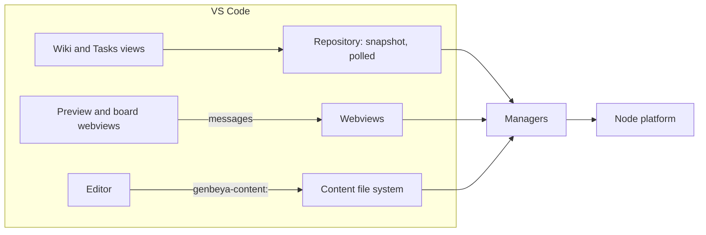

# VS Code

The VS Code extension (`src/shells/vscode/`) is a fourth shell. It doesn't host the Angular client: the managers run in VS Code's extension host, native tree views list the pages and the tasks, and two kinds of small webviews show what trees can't: a **preview** tab per page or task, rendered as the app renders it, and the **board**. Pages and tasks open in VS Code's own editor to edit their text; a task's properties and comments change in its preview, through VS Code's pickers. The work is tracked in [[GENBEYA-21]].

| File | What it does |
| --- | --- |
| `extension.ts` | Activation: creates the managers on the Node platform (preferences in the extension's global storage), opens the first workspace folder that holds a Git repository, registers the views and commands |
| `repository.ts` | The open repository: its snapshot, polled every four seconds while the window has focus, and on focus and save, like the client polls it |
| `wiki-view.ts` | The page tree. A click opens the preview; the inline actions are **Preview** and **Edit** |
| `tasks-view.ts`, `task-groups.ts` | The tasks as a tree, one group per workflow state, with the same actions; dragging tasks onto a state moves them. The context menu changes status, type, priority, assignee, epic and labels, renames and deletes. The title bar opens the board |
| `task-actions.ts` | Changing tasks with quick picks and input boxes, as the app's task panel does with its menus; edits are queued, each applied to the newest version of the task |
| `webviews.ts` | The preview tabs and the board: what they show, and the links, edits, moves, comments and checkbox toggles they report. VS Code reopens them after a restart |
| `webview/` | The webviews' code, bundled for the browser: the message protocol, the Markdown renderer, the task view, the preview, the board, and styles from the app's tokens over VS Code's theme |
| `content-files.ts` | The `genbeya-content` file system, for areas on the [Content branch](Content-branch.md) |
| `manifest.json` | The extension's `package.json`; `scripts/build-vscode.mjs` adds the app's version |
| `test/smoke.ts` | The smoke test, run inside VS Code |

## Preview and board

Every page and task has a preview tab of its own, so the editor's tabs and Go Back work as for files. Links to pages and tasks open their tabs, links to other files open in the editor (with the lines of `#L10-L20` selected), web links in the browser after VS Code asks. While the document is open in the editor, the preview follows its unsaved text. **Edit** in the preview's title bar opens the file. Ticking a checklist item saves the file; while its editor has unsaved changes, the preview asks to save first. A task that moves to another epic is another file; its tab follows it by ID.

A task's preview works like the app's task panel: its title and its properties (status, type, priority, assignee, epic, labels) are buttons that open VS Code's quick picks, custom fields are inputs, comments can be written and the user's own edited and deleted, and the activity shows who changed what. The app's task rules (`features/tasks/task-model.ts`: the people, epics and labels to offer, sorting and filtering) and its activity texts (`task-changes.ts`) are shared, not copied.

The board has a column per workflow state, leaving out the hidden columns, with the app's filters (text, assignee, label, priority, type, epic) and optionally a swimlane per epic; it remembers them across restarts. Cards drag between columns, and between swimlanes, which moves the task into that epic. **+** in a column creates a task there. A click opens the task in a popup, with the same view as its preview tab, **Open in Preview**, **Edit File** and **Delete**.

Both render Markdown with the client's own pipeline (`src/client/app/markdown/`: parsing, the allowlisted DOM builder, references, mentions, dates, embeds) and draw Mermaid, PlantUML (rockuml's WebAssembly) and KaTeX themselves, loaded on first use. Markdown never becomes HTML, as in the app ([Security](Security.md)). Webviews only render and report clicks; they read nothing themselves. Images and embedded files come from the extension, through the managers, which check every path. Their content security policy allows only the extension's own scripts and styles, data and blob images, and WebAssembly.

## Where files open

An area in the checkout opens as the plain file, so VS Code's Git support, search and other extensions see it as usual. An area on the content branch opens as `genbeya-content:/<path>`: reads and saves go through the content manager, which commits each save on the content branch, as the app does. A save based on a version that changed meanwhile fails instead of overwriting the newer version. Editing the files in `.git/genbeya/` directly would leave the edits uncommitted.

## Remote workspaces

The manifest's `extensionKind` is `workspace`, so VS Code runs the extension where the workspace is: in WSL, over SSH or in a dev container, it runs there, and the managers see a local repository. The desktop app's own WSL and SSH hosts are not needed. Genbeya runs Git in the repository, which can run programs the repository configures, so the extension stays off in untrusted workspaces.

## Decisions

- **One repository, one version.** The extension lives in this repository and reuses the contracts, engines, managers and the client's Markdown rendering directly. It carries the app's version, so `scripts/version.mjs` needs no new file.
- **Native where VS Code has it.** Trees for lists, the editor for editing, quick picks for choices. Webviews only where VS Code has nothing to offer: rendered pages and tasks, and the board. They are small, purpose-built pages with VS Code's colours and fonts, not the app's client, which would duplicate VS Code's editor, Git and terminal.
- **No terminal.** The extension never opens terminals, so node-pty is not packaged.

## Not yet

See the tasks: [[GENBEYA-22]] (references in VS Code's Markdown editor), [[GENBEYA-23]] (what is left of editing tasks), [[GENBEYA-24]] (Genbeya's Git tools as a view) and [[GENBEYA-25]] (publishing). Only the first Git repository among the workspace folders is shown.
