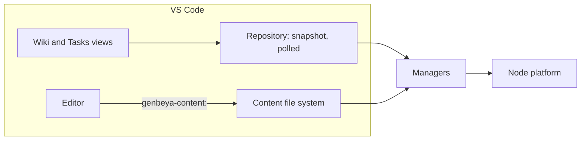

# VS Code

The VS Code extension (`src/shells/vscode/`) is a fourth shell. Unlike the desktop shells it has no webview: the managers run in VS Code's extension host, and native views show the wiki and the tasks. Pages and tasks open in VS Code's own editor, as the Markdown files they are. The work is tracked in [[GENBEYA-21]].

| File | What it does |
| --- | --- |
| `extension.ts` | Activation: creates the managers on the Node platform (preferences in the extension's global storage), opens the first workspace folder that holds a Git repository, registers the views and commands |
| `repository.ts` | The open repository: its snapshot, polled every four seconds while the window has focus, and on focus and save, like the client polls it |
| `wiki-view.ts` | The page tree |
| `tasks-view.ts`, `task-groups.ts` | The board as a tree, one group per workflow state; dragging tasks onto a state, or **Move to…**, updates their status through the content manager |
| `content-files.ts` | The `genbeya-content` file system, for areas on the [Content branch](Content-branch.md) |
| `manifest.json` | The extension's `package.json`; `scripts/build-vscode.mjs` adds the app's version |
| `test/smoke.ts` | The smoke test, run inside VS Code |

## Where files open

An area in the checkout opens as the plain file, so VS Code's Git support, search and other extensions see it as usual. An area on the content branch opens as `genbeya-content:/<path>`: reads and saves go through the content manager, which commits each save on the content branch, as the app does. A save based on a version that changed meanwhile fails instead of overwriting the newer version. Editing the files in `.git/genbeya/` directly would leave the edits uncommitted.

## Remote workspaces

The manifest's `extensionKind` is `workspace`, so VS Code runs the extension where the workspace is: in WSL, over SSH or in a dev container, it runs there, and the managers see a local repository. The desktop app's own WSL and SSH hosts are not needed. Genbeya runs Git in the repository, which can run programs the repository configures, so the extension stays off in untrusted workspaces.

## Decisions

- **One repository, one version.** The extension lives in this repository and reuses the contracts, engines and managers directly. It carries the app's version, so `scripts/version.mjs` needs no new file.
- **Native views over webviews.** VS Code users expect trees, editors and quick picks; a webview would also duplicate the editor, Git and the terminal that VS Code has. The board becomes a tree grouped by state; things trees cannot show (comments, activity, custom fields) get native forms or quick picks one by one.
- **No terminal.** The extension never opens terminals, so node-pty is not packaged.

## Not yet

See the tasks: [[GENBEYA-22]] (Markdown references and preview), [[GENBEYA-23]] (editing tasks natively), [[GENBEYA-24]] (Genbeya's Git tools as a view) and [[GENBEYA-25]] (publishing). Only the first Git repository among the workspace folders is shown.
