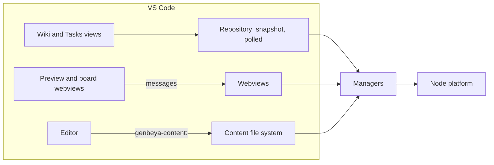

# VS Code

The VS Code extension (`src/shells/vscode/`) is a fourth shell. It doesn't host the Angular client: the managers run in VS Code's extension host, native tree views list the pages and the tasks, and two kinds of small webviews show what trees can't: a **preview** tab per page or task, rendered as the app renders it, and the **board**. Pages and tasks open in VS Code's own editor to edit their text; a task's properties and comments change in its preview, through VS Code's pickers. The work is tracked in [[GENBEYA-21]].

| File | What it does |
| --- | --- |
| `extension.ts` | Activation: creates the managers for this computer's repositories (`createLocalBackend`) on the Node platform without terminals (preferences in the extension's global storage), opens the first workspace folder that holds a Git repository, registers the views and commands |
| `repository.ts` | The open repository: its snapshot, polled every four seconds while the window has focus, and on focus and save, like the client polls it |
| `wiki-view.ts` | The page tree. A click opens the preview; the inline actions are **Preview** and **Edit** |
| `tasks-view.ts`, `task-groups.ts` | The tasks as a tree, one group per workflow state, or grouped by epic first (a toggle in the title bar), with the same actions; dragging tasks onto a state moves them. The context menu changes status, type, priority, assignee, epic and labels, renames and deletes. The title bar opens the board |
| `markdown-language.ts`, `markdown-references.ts` | Genbeya's Markdown in VS Code's editor: `[[`, `@` and `//` completion, hovers and links on references, warnings for references to nothing, the preview beside the editor |
| `task-actions.ts` | Changing tasks with quick picks and input boxes, as the app's task panel does with its menus; edits are queued, each applied to the newest version of the task |
| `webviews.ts` | The preview tabs and the board: what they show, and the links, edits, moves, comments and checkbox toggles they report. VS Code reopens them after a restart |
| `webview/` | The webviews' code, bundled for the browser: the message protocol, the renderer's host (`renderer-host.ts`), the task view, the preview, the board, and styles from the app's tokens over VS Code's theme |
| `content-files.ts` | The `genbeya-content` file system, for areas on the [Content branch](Content-branch.md) |
| `revision-files.ts` | Read-only `genbeya-revision:/<path>?<revision>` documents: a file as committed in a revision, which pinned references open |
| `manifest.json` | The extension's `package.json`; `scripts/build-vscode.mjs` adds the app's version |
| `test/smoke.ts` | The smoke test, run inside VS Code |

## Preview and board

Every page and task has a preview tab of its own, so the editor's tabs and Go Back work as for files. Links to pages and tasks open their tabs, links to other files open in the editor (with the lines of `#L10-L20` selected), links pinned to a revision (`#L10-L20@v1.0`) as a read-only document of that version, web links in the browser after VS Code asks. While the document is open in the editor, the preview follows its unsaved text. **Edit** in the preview's title bar opens the file. Ticking a checklist item saves the file; while its editor has unsaved changes, the preview asks to save first. A task that moves to another epic is another file; its tab follows it by ID.

A task's preview works like the app's task panel: its title and its properties (status, type, priority, assignee, epic, labels) are buttons that open VS Code's quick picks, custom fields are inputs, comments can be written and the user's own edited and deleted, and the activity shows who changed what. The app's task rules (`features/tasks/task-model.ts`: the people, epics and labels to offer, sorting and filtering) and its activity texts (`task-changes.ts`) are shared, not copied.

The board has a column per workflow state, leaving out the hidden columns, with the app's filters (text, assignee, label, priority, type, epic) and optionally a swimlane per epic; it remembers them across restarts. Cards drag between columns, and between swimlanes, which moves the task into that epic. **+** in a column creates a task there. A click opens the task in a popup, with the same view as its preview tab, **Open in Preview**, **Edit File** and **Delete**.

Both render Markdown with the renderer they share with the [Kit](Kit.md) (`src/shells/webview/markdown-renderer.ts`), which uses the client's own pipeline (`src/client/app/markdown/`: parsing, the allowlisted DOM builder, references, mentions, dates, embeds, plans) and draws Mermaid, PlantUML (rockuml's WebAssembly) and KaTeX itself, loaded on first use. `[BURNDOWN]` and `[BASELINE]` ask the extension for the plan's history, and a ticked checkbox names the version it was shown in, so a file that changed meanwhile is left alone. Markdown never becomes HTML, as in the app ([Security](Security.md)). Webviews only render and report clicks; they read nothing themselves. Images and embedded files, also as committed in a revision, come from the extension, through the managers, which check every path. Their content security policy allows only the extension's own scripts and styles, data and blob images, and WebAssembly.

## In VS Code's editor

Markdown files of the repository, pages and tasks above all, get what the app's editor offers: `[[` completes tasks, pages and files, `@` the repository's people and `//` dates, with the app's rules (`references.ts`, `mention-suggestions.ts`, `smart-dates.ts`). A reference shows its task's title and status, or its page's title, on hover; Ctrl+click opens it, and a reference to nothing is a warning. References in code blocks and code spans are text, as in the preview. **Open Preview to the Side** in a page's or task's title bar opens its preview beside the editor, which scrolls along by share of the length. The comment box in a task's preview offers the same completion.

## Where files open

An area in the checkout opens as the plain file, so VS Code's Git support, search and other extensions see it as usual. An area on the content branch opens as `genbeya-content:/<path>`: reads and saves go through the content manager, which commits each save on the content branch, as the app does. A save based on a version that changed meanwhile fails instead of overwriting the newer version. Editing the files in `.git/genbeya/` directly would leave the edits uncommitted.

## Remote workspaces

The manifest's `extensionKind` is `workspace`, so VS Code runs the extension where the workspace is: in WSL, over SSH or in a dev container, it runs there, and the managers see a local repository. The desktop app's own WSL and SSH hosts are not needed. Genbeya runs Git in the repository, which can run programs the repository configures, so the extension stays off in untrusted workspaces.

## What the extension leaves out

The Visual Studio Marketplace refused the extension within seconds, by an automated check: "Your extension has suspicious content. Please fix your extension metadata", naming no rule ([[GENBEYA-25]]).

**Keywords.** Probe uploads, each a new extension with empty code and one piece of Genbeya's metadata, found the cause: the manifest's `keywords`. Every other piece passed, the display name, the README, the licences and the homepage on genbeya.fyi included ([[GENBEYA-66]] has the results). Which keyword it is wasn't tested, so the manifest has none; they can come back one at a time in updates once the extension is listed. The Marketplace blocks uploads for 12 hours after seven or eight new extensions in a row, so probes are best spent sparingly. It also keeps the display name of a removed extension reserved: the accepted probe named "Genbeya" still holds that name, so the extension is listed as "Genbeya for VS Code". A probe should never carry a name the real extension needs.

**Code nobody runs.** Before the probes, the bundle looked like the likelier cause. The extension carried the desktop app's whole backend, and with it code that reads like a remote access tool to a scanner looking for patterns: PowerShell started with hidden windows, `taskkill /f`, node-pty, `ssh -t … exec "$SHELL" -l`, `wsl.exe`, a script that sets up a shell on another machine, and a base64 command-line argument decoded and opened. None of it ran in VS Code.

The extension builds its managers with `createLocalBackend` ([Managers](Managers.md)) on a Node machine without terminals: no WSL or SSH hosts, no folder browsing there, no launch arguments, no terminals ([[GENBEYA-66]]). What it still starts is `git`. `scripts/build-vscode.mjs` fails when `extension.cjs` names PowerShell, `pwsh`, `taskkill`, node-pty, `wsl.exe`, `BatchMode`, `--open=`, `mktemp` or `exec "$SHELL"`, so a new import can't bring them back unnoticed.

## Decisions

- **One repository, one version.** The extension lives in this repository and reuses the contracts, engines, managers and the client's Markdown rendering directly. It carries the app's version, so `scripts/version.mjs` needs no new file.
- **Native where VS Code has it.** Trees for lists, the editor for editing, quick picks for choices. Webviews only where VS Code has nothing to offer: rendered pages and tasks, and the board. They are small, purpose-built pages with VS Code's colours and fonts, not the app's client, which would duplicate VS Code's editor, Git and terminal.
- **No terminal, no remote hosts.** VS Code has both, so the extension leaves them out, see below.

## Not yet

See [[GENBEYA-24]] (Genbeya's Git tools as a view). Only the first Git repository among the workspace folders is shown.
