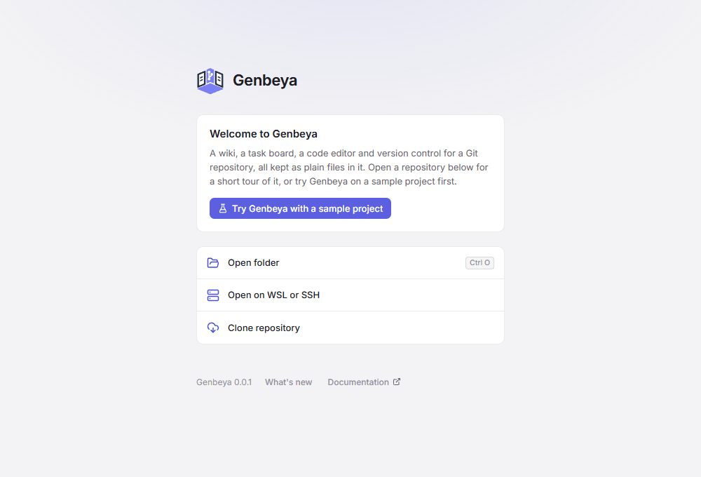

# Getting started

[TOC]

## Install

Download an installer from the [latest release](https://github.com/genbeya/genbeya/releases/latest). Genbeya comes in three variants of the same app; pick one:

| Variant | Pick it when | Differences |
| --- | --- | --- |
| **Electron** | You want the most tested build. The safe choice | Ships its own Chromium, so it looks and behaves the same everywhere; the largest download (about 110 MB) |
| **Tauri** | You want a small, light install | About 8 MB; uses the system's webview (WebView2 on Windows, WebKit on macOS and Linux). macOS: Apple silicon only |
| **Deno Desktop** | You like trying experiments | Experimental. No [Terminal](Guide/Terminal.md), and `genbeya://` links must be pasted into the command palette. macOS: Apple silicon only |

| System | Electron | Tauri | Deno Desktop |
| --- | --- | --- | --- |
| Windows | `-setup.exe` | `-setup.exe` or `.msi` | `.msi` |
| macOS | `.dmg`, Apple silicon (`arm64`) or Intel (`x64`) | `.dmg` | `.dmg` |
| Linux | `.AppImage` | `.AppImage`, `.deb` or `.rpm` | `.AppImage` or `.deb` |

The variants install side by side, as "Genbeya", "Genbeya Tauri" and "Genbeya Deno", each with its own settings. A newer installer of a variant replaces the version you have installed. [Runtimes](Architecture/Runtimes.md) compares them in detail.

The installers are not signed yet, so your system asks before running them the first time:

- **Windows**: when SmartScreen warns, choose *More info → Run anyway*.
- **macOS**: open the app the first time with right-click → *Open*, or run `xattr -dr com.apple.quarantine "/Applications/Genbeya.app"` (or `Genbeya Tauri.app`, `Genbeya Deno.app`).
- **Linux**: make the AppImage executable with `chmod +x Genbeya-*.AppImage`.

Genbeya needs **Git** on the machine that holds the repository: this computer, the WSL distribution or the SSH server. To run Genbeya from source instead, see [Development](Development.md).

## First start



The start screen opens a repository, and on the first start it introduces Genbeya.

**Try Genbeya with a sample project** asks for a folder, creates the repository `genbeya-sample` in it and opens it: *Pocket Weather*, a small project whose wiki shows references, embeds, subpages and diagrams, with tasks in every state, an epic and a task template, a few commits and one change left to commit. Delete the folder when you are done, or keep what you like: like everything Genbeya writes into your repositories, the sample is under the [MIT License](../LICENSE-MIT.md).

The first time a repository opens, the sidebar offers a tour: **Show me around** walks through the views, the wiki editor, the board, version control, the terminal, the command palette, settings and sharing, pointing at each. Try things while it runs; `Esc` or **Skip tour** ends it. Run **Start the tour** from the command palette (`Ctrl+K`) or **Settings → Help** to see it again.

After an update, **What's new** lists what changed since the version you used last; **Show me** points at the new things. **Settings → Help** shows the version and opens the notes, the tour and this documentation.

## Open a repository

| From | How |
| --- | --- |
| This computer | **Open folder** (`Ctrl+O`). Any folder inside a Git working tree works. |
| WSL | **Open on WSL or SSH** → WSL, pick the distribution and enter a Linux path or **Browse…** for it. Picking a `\\wsl$\…` folder in the folder dialog also opens it through WSL. |
| SSH | **Open on WSL or SSH** → SSH, enter `user@host` (or a `Host` from `~/.ssh/config`) and the repository path, or **Browse…** for it. |
| A remote URL | **Clone repository**, then choose where the clone goes — locally, on WSL or over SSH. |

On WSL and SSH, Git runs on the remote machine; Genbeya talks to it through one long-lived shell. See [Hosts](Architecture/Hosts.md).

**Browse…** shows the folders on the remote machine, starting at the path you typed or at your home folder. Double-click a folder (or select it and press `Enter`) to go into it, `Backspace` goes up, and typing the start of a name selects it. Git repositories are marked; when opening, select one and choose **Open** to open it right away. You can also type a path into the field at the top (`~` is your home folder) and press `Enter`. Hidden folders appear with **Show hidden folders**.

> [!NOTE]
> SSH connections run in batch mode: Genbeya never asks for passwords. Use an SSH agent or key, and connect once in a terminal so the host key is trusted.

Recently opened repositories appear on the start screen and in the repository menu at the top of the sidebar. Genbeya reopens the last one on start; turn that off in **Settings → App**.

## Make it yours

A repository works without any setup: the wiki is `docs/`, the tasks are `tasks/`, and the board has the columns backlog, todo, in progress, review and done. Change any of that in **Settings**, which saves it to `.genbeya.yml` for the whole team:

```yaml
name: Pocket Weather
taskPrefix: PW        # new tasks are PW-1, PW-2, …
statuses: [todo, in-progress, review, done]
types: [feature, bug, docs, chore]
```

[Settings](Guide/Settings.md) describes every key. Then read the [Guide](Guide.md), starting with the [Wiki](Guide/Wiki.md), [References](Guide/References.md) and [Tasks](Guide/Tasks.md).
