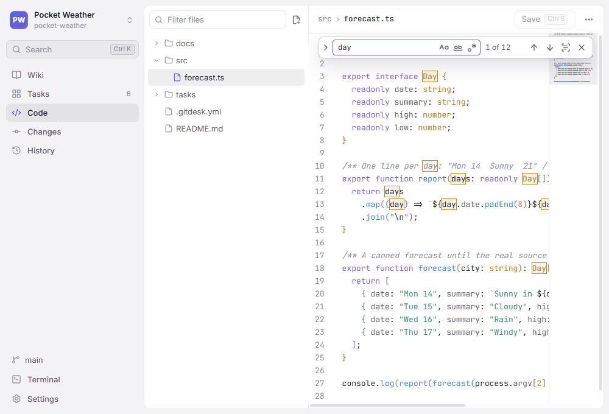

# Code

The **Code** view (`Ctrl+3`) lists the repository's files, without those `.gitignore` excludes. Select one to edit it; `Ctrl+S` saves, and the change shows up in **Changes**. `/` filters the file list, the button above it creates a file, and the `…` menu of a file shows its changes, copies links to it (see [Sharing](Sharing.md)) or deletes it.

The same editor edits wiki pages and task descriptions. It works like VS Code's for everyday editing — every key is in [Keyboard shortcuts](Keyboard-shortcuts.md).

[TOC]

## Previews

Markdown files, Mermaid (`.mmd`) and PlantUML (`.puml`) diagrams and SVG images switch between **Edit**, **Split** (the text and the preview side by side) and **Preview**; new files open in the mode you chose last. The preview renders like the wiki, including [References](References.md) and diagrams, and typing `[[` in a Markdown file lists the tasks, pages and files to link. Switching keeps your place in Markdown, and in **Split** the two sides scroll together.

Images — PNG, JPEG, GIF, WebP and AVIF — open as a picture, with their size in pixels and their file size next to the name, such as *96 × 96 px · 1.2 KB*. They have no text to edit, so there is no **Edit**, **Split** or **Save**. Images up to 10 MB are shown, as in pages. Other binary files can't be opened. **Changes** and **History** compare two versions of an image side by side or swiped (see [Version control](Version-control.md#images-and-other-binary-files)).

## Find and replace

`Ctrl+F` opens the find bar at the top right, filled in with the selected text. `Ctrl+H` (`⌥⌘F` on macOS) opens it with a replacement field.

- The buttons in the field match case, whole words only, or treat the text as a regular expression; a replacement can then use the groups as `$1`, `$2`.
- The counter shows which match is selected and how many there are ("3 of 12"). An invalid regular expression turns the field red.
- `Enter` and `Shift+Enter` go to the next and previous match, `Alt+Enter` selects all of them to type over them at once. In the replacement field, `Enter` replaces one match and `Ctrl+Alt+Enter` all of them.
- **Find in selection** limits the search to the text selected when you turn it on.
- `Esc` closes the bar and returns to the text.

`Ctrl+G` jumps to a line (`120`, `+10`, `50%`, or `120:8` for a column).

## Several cursors

`Alt`+click adds a cursor; `Ctrl+Alt+↑` / `↓` add one on the line above or below. `Ctrl+D` selects the next occurrence of the selection (or of the word at the cursor), `Ctrl+Shift+L` all of them; whatever you type then changes every one. `Shift+Alt`+drag, or dragging with the middle mouse button, selects a rectangle. `Esc` goes back to a single cursor.

## Folding

Point at the line numbers to see arrows beside every block that folds: functions, classes and other bracketed blocks in code, sections under a heading in Markdown. A folded block shows as `⋯`; click it to open it again. `Ctrl+Alt+[` folds everything, `Ctrl+Alt+]` unfolds everything.

## Reading aids

- The bracket pair at the cursor is outlined; a bracket without a partner is red. Nested pairs take turns in three colours.
- Code files show a **minimap** on the right: click or drag it to scroll. Turn it off in **Settings** or with **Toggle minimap** in the command palette. Markdown and text files and narrow editors have none.
- `Alt+Z` switches word wrap; Markdown and text files wrap by default.
