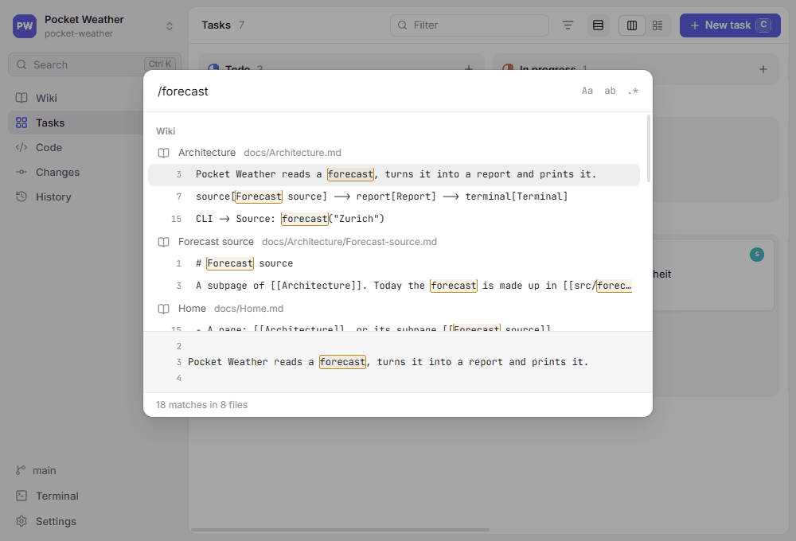

# Search

Search finds text inside pages, tasks and code. To jump to a page, task or file by its name, use `Ctrl+K` instead.

## Starting a search

- Press `Ctrl+Shift+F`, or
- press `Ctrl+K` and type `/` before the text, or
- choose **Search in files…** in the `Ctrl+K` palette.

Results appear as soon as you pause typing.

## What you type

`/flux capacitor` finds the text `flux capacitor` as written, ignoring case; spaces and characters such as `.`, `*` or `-` count literally. Three switches next to the field change that (on macOS, the keys are `⌥⌘` and the letter):

| Switch | Keys | Effect |
| --- | --- | --- |
| `Aa` | `Alt+C` | Match case |
| `ab` | `Alt+W` | Whole words only: `log` does not find `login` |
| `.*` | `Alt+R` | Regular expression, as `git grep -E` reads it: `colou?r`, `TODO|FIXME`, `^import` |

## Results

Matches are grouped into **Wiki**, **Tasks** and **Code**. Each file is listed once, with its matching lines below it and the match highlighted; the lines around the selected match show at the bottom. `↑` and `↓` move, `Enter` opens:

- a page scrolls to the section the line is in,
- a task opens in its panel,
- a file opens in the editor with the line selected.

The status line counts the matches. Search lists up to 30 files per group and 10 lines per file, and shortens long lines around the match; when it left something out, the status line says *more not shown*, and a more specific search finds the rest.

## What is searched

- Files Git tracks, and new files not committed yet, such as a page created a moment ago.
- Not files that `.gitignore` excludes, and not binary files such as images.
- Pages and tasks come from wherever their area lives, the checkout or the [Content branch](../Architecture/Content-branch.md), and code from your checkout; the copy an area on the content branch left in the checkout is not listed twice.

Search runs `git grep` on the machine the repository lives on, so it works the same for repositories on WSL and over SSH.
