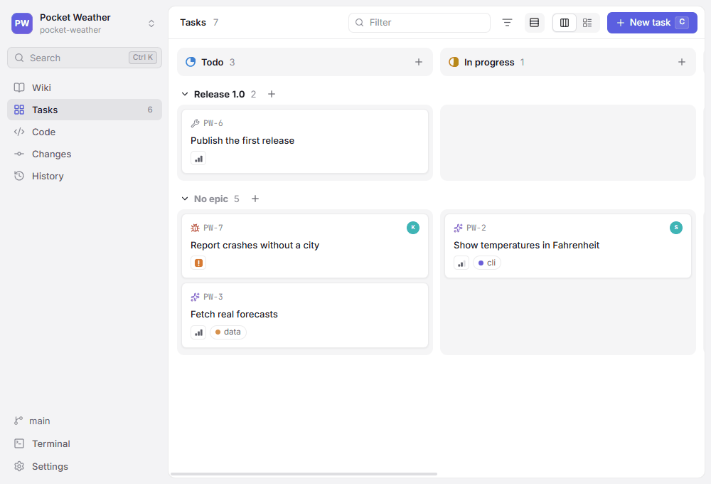
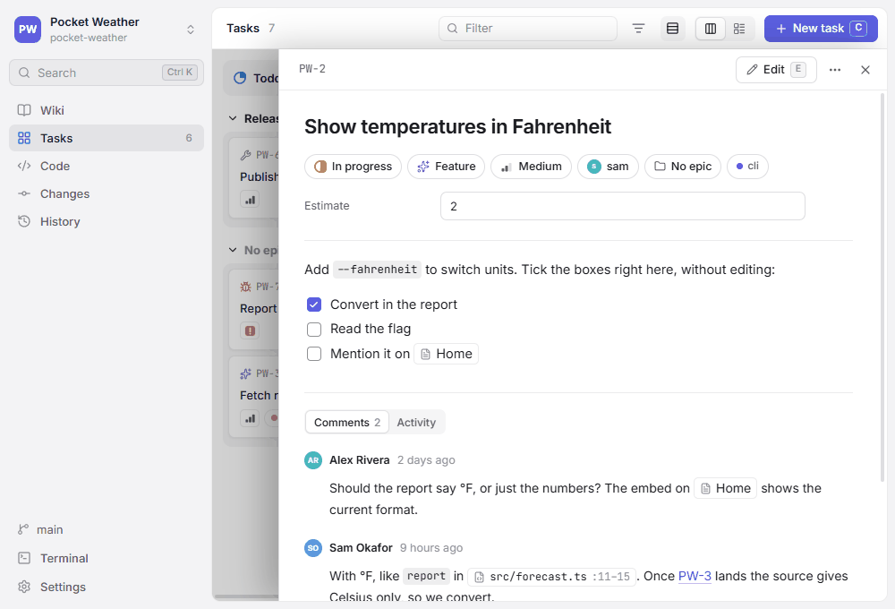

# Tasks

The **Tasks** view (`Ctrl+2`) shows the project's tasks on a board or in a list. Each task is one Markdown file in the task folder (`tasks/` unless **Settings** names another), named after its ID:



[TOC]

## The task file

```markdown
---
id: GENBEYA-12
title: Virtualize long lists
type: improvement
status: todo
priority: medium
assignee: alice
labels: [performance]
---

Render only visible rows in the file tree and history.

- [ ] File tree
- [ ] History
```

- IDs are `PREFIX-number`; the prefix is set in **Settings** (`taskPrefix`). IDs stay unique across epics.
- `status` is one of the workflow states, `priority` is `urgent`, `high`, `medium` or `low` (none when left out), `type` one of the task types.
- Extra frontmatter fields and YAML comments survive edits made in GitDesk; configure them as [custom fields](#custom-fields) to edit them in GitDesk too.

Write `[[GENBEYA-12]]` in a page, a description or a comment to show the task's title and current status anywhere; a plain `GENBEYA-12` links too. See [References](References.md).

Task files change with the checked-out branch and are committed like code. To see the same board on every branch, keep the tasks on the shared [Content branch](../Architecture/Content-branch.md) (**Settings → Where content lives → Tasks**); every change is then committed there right away, while the wiki can stay with the code.

## The board

- Drag cards between columns to change their status. **Board** and **List** switch the layout; the list shows every task, including those in hidden columns.
- `C` (or **New task**) creates a task, `+` at the top of a column creates one in that column.
- `/` filters by text; **Filter by** narrows the board and the list to a type, an epic, an assignee, a priority or a label.
- A card shows the task's type, ID, title, assignee, priority and labels.

## The task panel

Click a card to open the task beside the board.



- Status, type, priority, assignee, epic and labels change right away from the chips under the title; custom fields sit below them.
- Checkboxes in the description can be ticked without editing.
- `E` (or **Edit**) edits the title and description, with `[[` completion for [References](References.md). `Ctrl+S` or `Ctrl+Enter` saves, `Esc` cancels, and `Esc` again closes the panel.
- The `…` menu copies links to the task (see [Sharing](Sharing.md)) and deletes it.

## Comments

Below the description, **Comments** lists what people wrote about the task. Type in the box and press `Ctrl+Enter` (`⌘Enter` on macOS) to add a comment. Markdown and `[[references]]` work as in the description; the box offers no `[[` completion, so type references in full. Your own comments have buttons to edit and delete them.

Comments are signed with your Git name (`git config user.name`, or the name Git takes from your system account) and stored at the end of the task file, so they read well anywhere Markdown is shown:

```markdown
---
id: GENBEYA-12
title: Virtualize long lists
status: todo
---

Render only visible rows in the file tree and history.

## Comments

### Ada Lovelace — 2026-10-10 14:32+02:00

The history needs it most.

### Alan Turing — 2026-10-11 09:05+02:00

Agreed, see [[GENBEYA-14]].
```

- The comments start at the first `## Comments` heading that is followed by a comment heading: `### Name — date time`, with the time to the minute and the UTC offset.
- New comments go last, so comments written on two branches merge cleanly.
- Editing the description never changes the comments, and the other way round.
- A line in a description or comment that would read as a comment heading is saved with a leading `\`.

## Activity

**Activity**, next to Comments, shows who changed the task and when, from the Git history of its file: status, type, priority, assignee, title, epic and custom fields with their old and new values, added and removed labels, description edits, and added, edited or deleted comments. It follows the task when it moves between epics, and lists the latest 100 commits; click a commit to open it in [History](Version-control.md#history).

Changes saved but not committed yet come first, marked *Not committed yet*. When the tasks live on the [Content branch](../Architecture/Content-branch.md), every edit is committed right away, so the activity is always complete.

## Epics

An epic is a folder in the task folder: `tasks/Login rework/GENBEYA-14.md` belongs to the epic *Login rework*. Folders can nest (`Auth/Tokens`). IDs stay unique across epics.

- **Epic** under a task's title moves it into another epic, or into a new one; the file moves along.
- **Swimlanes by epic**, next to the layout switch, shows one row per epic on the board. Dragging a card into another row moves it to that epic.
- **Filter by** narrows the board and the list to one epic.

## Workflow states

The board's columns are the workflow states, set in **Settings → Workflow** (`statuses` in `.gitdesk.yml`), in order; the last one counts as done. To keep the board short, untick a state in the list layout: it disappears from the board for everyone (`hiddenColumns` in `.gitdesk.yml`) and stays in the list. Tasks in a state that is no longer configured appear in an extra column so nothing gets lost — move them into a configured state.

### Column icons

A state shows a ring that fills as work advances, and a check for the last one. To give a column its own icon, pick one next to the state in **Settings → Workflow**. In `.gitdesk.yml` such a state is written as a name with an icon; states without one stay plain names:

```yaml
statuses:
  - todo
  - name: in-progress
    icon: play
  - name: done
    icon: flag
```

## Types

A task can have a type, such as bug or feature: its icon shows on the card, in the list and under the title, where **Type** changes it. **Filter by** narrows the board to one type. Without `types` in `.gitdesk.yml`, the types are bug, feature, improvement and chore. Configure your own in **Settings → Task types**, with an icon and an optional colour each:

```yaml
types:
  - name: bug
    icon: bug
    tone: red         # gray, blue, green, yellow, orange, red or purple
  - name: spike
    icon: flask-conical
  - feature           # a name alone brings its usual icon and colour
```

A list of names, such as `types: [bug, feature]`, works too: well-known names (bug, feature, improvement, chore, task, story, docs, question, research) get their usual icon, others a generic one. A task whose type is not configured keeps it and shows the generic icon. `types: []` turns types off.

### Templates

Choosing a type for a new task fills its description from the type's template, a Markdown file in the task folder named after the type: `tasks/.templates/bug.md`. Frontmatter in the template presets the new task's priority, assignee, labels and custom fields, unless you set them already:

```markdown
---
priority: high
labels: [bug]
---

## Steps to reproduce

## Expected

## Actual
```

The template button next to a type in **Settings → Task types** opens its template in **Code**, and creates it first if there is none. Templates live with the tasks: when the tasks are on the [Content branch](../Architecture/Content-branch.md), the button names the file there instead, since **Code** shows the checkout. Folders in the task folder whose names start with a dot hold no tasks, so `.templates` is no epic.

## Custom fields

Fields that every task of the project should have, such as an estimate or a due date, are configured in **Settings → Custom fields**, or as `fields` in `.gitdesk.yml`:

```yaml
fields:
  - name: estimate
    type: number
  - name: due
    type: date        # written as 2026-05-01
  - name: area
    type: choice
    options: [ui, backend, docs]
  - name: reviewer    # text, unless a type is given
```

They appear under a task's properties and are saved to its frontmatter as you change them; emptying a field removes it from the file. Names start with a letter and use letters, digits, `-` and `_`; GitDesk's own keys (id, title, type, status, priority, assignee, labels, epic) are taken. Field types are `text`, `number`, `date` and `choice`. Other frontmatter fields of a task show below the configured ones, read-only, and are never lost: removing a field from the settings leaves the values in the task files.

Every key of `.gitdesk.yml` is described in [Settings](Settings.md).
