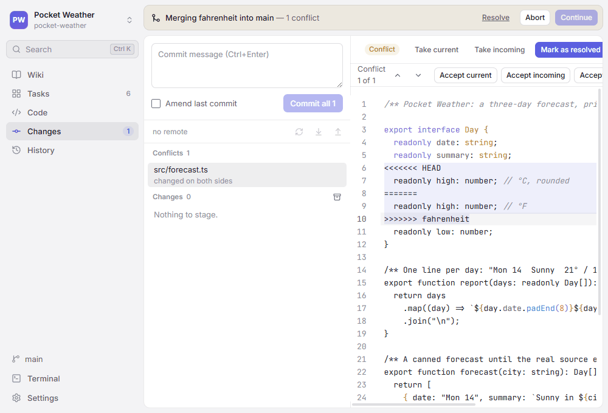

# Version control

**Changes** (`Ctrl+4`) and **History** (`Ctrl+5`) cover the Git work of every day — commit, branch, push, merge, rebase, reset, stash, and resolve conflicts — without leaving the window.

[TOC]

## Changes

The **Changes** view lists staged and unstaged files. Select a file to see its diff; switch between side-by-side and inline with the button in the corner.

- Stage or unstage files one by one or all at once, or parts of a file (see below).
- Discard reverts a file to its staged version; untracked files are deleted, with the folders that are empty afterwards. Genbeya asks first.
- Write a message and press `Ctrl+Enter`. With nothing staged, the button commits all changes.
- **Amend last commit** puts the last commit's changes back into the staged list (see [Amending](#amending)).
- Right-click a file for more: stage, discard, open it, add it to .gitignore or stop tracking it.

Fetch, pull (fast-forward only) and push sit above the file list, together with how far the branch is ahead of or behind its upstream. A branch without upstream shows **Publish branch** instead of push (see [Pushing](#pushing)). The **⋯** menu next to them has **Push to…** and **Undo last commit**, which takes the last commit off the branch and keeps its changes staged; **Redo** in the message afterwards puts it back.

### Staging hunks and lines

Commit only part of what you changed in a file. The diff of an unstaged file has a bar above every change with **Stage hunk** and **Discard hunk**; the diff of a staged file has **Unstage hunk**. Both the side-by-side and the inline diff have them.

To act on single lines, select them: click a line number, `Shift`+click another to select the lines between, or move with `Shift+↑` / `Shift+↓` inside the diff. The bar above the diff then offers **Stage selected lines**, **Discard selected lines** or **Unstage selected lines**. Side by side, select removed lines on the left and added lines on the right; a removed line goes along once you select all the lines that replace it, which is how the inline diff, where removed lines have no numbers, stages a changed line. Lines that did not change are left alone.

- Staging part of an untracked file adds the file with just those lines.
- Discarding asks first and cannot be undone.
- Binary files, and files Git does not compare line by line, are staged as a whole.
- When the file changed since its diff was shown, Genbeya refuses, shows the new diff, and you choose again. The diff is also shown anew when you come back to Genbeya from another app.
- Inline, a click next to the removed lines of a change selects the lines that replace them, which brings the removed ones along.

### Images and other binary files

The diff of an image — PNG, JPEG, GIF, WebP or AVIF — shows the version before and the version after instead of lines, each with its size in pixels and its file size:

- **Side by side** shows both next to each other. An added or deleted image shows *Not in this version* on the side that has none.
- **Swipe** lays the version after over the version before, at the same scale: left of the divider is before, right of it after. Drag the divider, or focus it and use `←` and `→` (`Home` and `End` go to the edges). Swiping needs both versions.

Genbeya remembers your choice. Images are staged, unstaged and discarded as whole files, from the file list. Other binary files show their size before and after, such as *12 KB → 14 KB*; files over 2 MB are not compared at all. SVG images are text: their diff shows the lines that changed.

### Tree

**Show as tree** (next to **Changes**) shows the staged and unstaged files in their folders; **Show as list** goes back. Genbeya remembers your choice. A folder shows how many changes it holds, and a folder that holds nothing but another folder shares its row, as `src/client/app`. Its buttons and menu stage, unstage or discard everything in it.

In the tree, `↑` and `↓` move between rows, `→` opens a folder (again: goes to its first entry), `←` closes it (or goes to the folder above), `Home` and `End` go to the first and last row, and `Enter` shows a file's diff or opens and closes a folder.

### Ignoring files

Right-click a file or folder in **Changes**:

- **Ignore file …** adds the file, **Ignore folder …** its folder (or the folder you clicked), and **Ignore all \*.ext files** every file with its extension.
- A dialog asks whether the rule goes into the repository's `.gitignore` or the one in the file's folder, and shows the line it adds, such as `/src/app/debug.log` or `*.log`. Names that `.gitignore` would read as patterns are escaped, and paths start with `/`, so the rule matches only that file. The file keeps its line endings, and the rule is added once.
- Git ignores only files it does not track. For a tracked file the dialog also offers **Stop tracking**, which keeps the file on disk but deletes it from the repository with the next commit. **Stop tracking…** in the menu does just that, after asking.

The changed `.gitignore` then shows up in **Changes**, ready to commit.

### Amending

Tick **Amend last commit** to change the last commit. Its message is loaded into an empty message box (a message you started stays), and the staged list shows everything the amended commit will hold: the last commit's changes plus whatever you stage on top.

- Unstage a file, a hunk or lines to leave them out of the commit: they stay in your working tree as unstaged changes.
- Stage more to add it.
- **Amend** commits exactly what is staged; untick the box to go back to normal. The message box then gets back what it held before, unless you edited the loaded message: your edits stay.

When the last commit is a merge, its changes are shown against its first parent, and the amended commit keeps all its parents. When the commit is already on a remote branch, Genbeya warns you: amending rewrites it, so you would have to force-push (see [Force push](#force-push)). There is nothing to amend before the first commit.

## Stashes

**Stash changes** (the box icon next to **Changes**) sets your uncommitted changes aside and cleans the working tree. Give the stash a message if you like; choose whether untracked files go along and whether staged changes stay in place.

Stashes are listed below the changes, newest first, with the branch they were made on. Select one to see its files and their diffs, then:

- **Pop** applies it and removes it from the list.
- **Apply** applies it and keeps it.
- **Branch…** creates a branch at the commit the stash was made on, switches to it and pops the stash there — useful when the stash no longer applies cleanly.
- **Drop…** deletes it. Genbeya asks first.

When a stash conflicts with your changes, the stash stays in the list and the conflicted files appear under **Conflicts** (see below).

## Branches

The branch button at the bottom of the sidebar switches branches; remote branches are checked out as tracking branches. Git refuses a switch that would overwrite local changes — commit, stash or discard them first.

Right-click a commit in **History** for everything else:

- **Create branch here…** starts a branch at the commit; tick **Switch to the new branch** to check it out right away.
- For each branch pointing at the commit: **Switch to**, **Rename…**, **Set upstream of…** (the remote branch pull and push use), **Push … to…** (see [Pushing](#pushing)) and **Delete…**. A branch with commits that are on neither its upstream nor the current branch is only deleted after a second confirmation, since its commits could be lost.
- For each remote branch: **Check out** (when there is no local branch of that name) and **Delete on the remote…**, which removes it for everyone.

## Pushing

The push button in **Changes** pushes the current branch to its upstream. A branch without upstream offers **Publish branch** instead: it pushes the branch to `origin` (or the only remote) under the same name and makes that its upstream, so pull and push know where to go from then on. With several remotes and none called `origin`, Genbeya asks which one.

**Push to…** — in the **⋯** menu of **Changes**, as **Push … to…** in the menu of a branch in **History**, and in the palette — pushes any local branch anywhere:

- **Remote** and **Remote branch**: by default the upstream, else the same name on `origin`. The name can differ, for example your `feature` to the remote's `main`. Genbeya warns when you push to the remote's default branch or to another branch the remote already has, unless it is the upstream.
- **Set as upstream** makes the remote branch the one pull and push use. It is ticked when the branch has no upstream yet.
- **Force (with lease)** replaces the remote branch; see below.

### Force push

When the remote branch has commits yours lacks — after you amended or rebased commits you had pushed, say — the remote rejects the push. The message offers **Force push with lease…**, and so does the push dialog.

Before anything happens, Genbeya lists the commits the remote branch loses: everyone who uses the remote loses them too. The push then only goes through while the remote branch is still where your last fetch saw it (`--force-with-lease` with that commit, plus `--force-if-includes` on Git 2.30 or newer). If someone pushed in the meantime, it fails with *origin/main changed since your last fetch* — fetch, look at what they pushed, and decide again. A fetch in between does not change what Genbeya expects; Genbeya never force pushes without a lease.

The remote's default branch, usually `main`, is the history everyone starts from: force pushing to it needs a tick in **I know, rewrite main anyway**.

## Resetting

Right-click a commit in **History** and choose **Reset … to here…** to move the current branch to that commit. The dialog explains what each mode keeps:

| Mode | The commits' changes | Your uncommitted changes |
| --- | --- | --- |
| **Soft** | staged | kept |
| **Mixed** (default) | in your files, unstaged | kept |
| **Keep** | gone | kept; refuses if the reset would overwrite them |
| **Hard** | gone | gone |

A hard reset lists the uncommitted files it would discard and needs **Discard my uncommitted changes** ticked; editors with unsaved edits are asked about first. When the commit has files you have but Git does not track on the branch now — say a `notes.txt` you created after it was deleted, or an ignored `.env` — hard and keep resets replace them with the commit's, so the dialog lists them and asks again. If your uncommitted changes change while the dialog is open, Genbeya refuses the reset and you look at it again. When some of the commits are already on the upstream, the dialog says so: afterwards the branch is behind it, a pull brings them back, and removing them there as well takes a [force push](#force-push). Genbeya does not reset during a merge, rebase, cherry-pick or revert.

The message after a reset has **Undo**, which moves the branch back with the same mode (a hard reset with **Keep**, which refuses to overwrite anything you changed since). After a hard reset that discarded uncommitted changes, or a reset that replaced files Git did not track, there is no **Undo**: the commits could come back, the changes could not.

## Tags

Tags show as yellow chips in **History**. Right-click a commit and choose **Create tag here…**; with a message the tag is annotated, without one it is lightweight. The menu also pushes a tag to the remote, deletes it here, or deletes it on the remote. Deleting asks first.

## Merging

To merge a branch into the current one, right-click a commit it points to in **History** and choose **Merge … into …**, or search the palette (`Ctrl+K`) for **Merge into …** and pick the branch. Remote branches and tags merge the same way.

The dialog shows the merge commit's message, which you can change. When the current branch has no commits of its own, Git just moves it forward and makes no merge commit; tick **Always create a merge commit** to get one anyway.

## Rebasing

Rebasing replays the current branch's own commits on top of another branch, for a straight history instead of a merge commit.

- **Rebase … onto …** in the menu of a branch, remote branch or tag in **History**, or **Rebase … onto…** in the palette. Genbeya says how many commits are replayed before it starts.
- **Pull from … by rebasing** in the palette fetches the upstream and replays your unpushed commits on top of it, instead of the fast-forward-only **Pull**.

Rebasing creates new commits. When some of them are already on a remote branch, Genbeya warns you: you would have to [force push](#force-push) that branch afterwards.

Uncommitted changes are stashed while a rebase runs and put back afterwards; if they no longer apply cleanly, they stay in the stash list.

### Interactive rebase

Right-click a commit of the current branch and choose **Rebase interactively from here…** to rewrite the commits after it. The dialog lists them oldest first:

- Drag a commit by its handle to reorder, or use its arrows or `Alt+↑` / `Alt+↓`.
- **Pick** keeps a commit, **Reword** keeps it with a new message, **Drop** leaves it out.
- **Squash** joins a commit to the one above it; the message box shows both messages, and follows reordering until you edit it. **Fixup** joins it and keeps the message above.

**Rebase** runs it all; no editor opens. Merge commits can't be rewritten this way — Genbeya refuses and suggests the terminal. Conflicts stop the rebase as described below.

## Cherry-pick and revert

Right-click a commit in **History**: **Cherry-pick onto …** applies its changes as a new commit on the current branch, **Revert…** undoes them with a new commit. Merge commits are left to the terminal, since Git needs to know which side to follow.

## Conflicts

When a merge, rebase, cherry-pick or revert conflicts, Git stops halfway. A banner above every view says what is going on — for example *Merging feature into main — 2 conflicts* — with:

- **Resolve**, while conflicts are left: goes to **Changes**, where they are listed.
- **Continue**, once every conflict is resolved: finishes the merge with its prepared message, or goes on with the next commit of a rebase.
- **Skip** (rebase, cherry-pick and revert): leaves out the commit Git stopped at, after asking.
- **Abort**: puts everything back as it was before the operation started. Genbeya asks first; resolutions made so far are lost.

Conflicted files are listed under **Conflicts** at the top of **Changes**. Select one to resolve it:

- The editor shows the file with Git's conflict markers. The bar above it steps through the conflicts; **Accept current** keeps your side (HEAD), **Accept incoming** the side being merged in, **Accept both** keeps both, yours first. Files written in Git's diff3 style also show the common ancestor, which accepting a side drops.
- Edit the result freely in the editor — the buttons always act on the conflicts still marked in the text.
- **Take current** and **Take incoming** in the header use one side for the whole file.
- **Mark as resolved** saves the result and stages it. With conflict markers left, Genbeya asks first.

Binary files offer only whole sides. A file one side deleted and the other changed offers to keep it or delete it.

> [!NOTE]
> During a rebase, *current* is the branch you rebase onto, with the commits already replayed, and *incoming* is the commit being replayed — that is how Git names the sides.

## History

**History** shows every branch with a commit graph. Select a commit to see its message and files; merges are compared with their first parent. Images are compared as in **Changes**, side by side or swiped (see [Images and other binary files](#images-and-other-binary-files)); so are the files of a stash.

> [!NOTE]
> Genbeya runs its own Git commands without repository hooks. Run Git in the [Terminal](Terminal.md) when a workflow depends on hooks.
