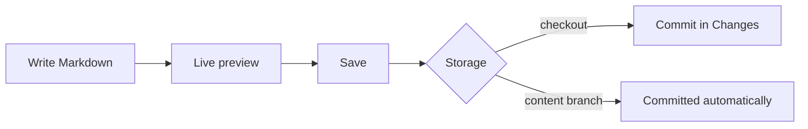

# Wiki

Every page is a Markdown file under the wiki folder (`docs/` by default). Press `E` to edit; the editor shows a live preview next to the source. `Ctrl+S` saves, `Esc` stops editing.

[TOC]

## Pages and subpages

A page and a folder with the same name belong together: `Guide.md` is the page, `Guide/` holds its subpages.

```text
docs/
├── Home.md
├── Guide.md          ← the "Guide" page
└── Guide/
    ├── Wiki.md       ← subpages of "Guide"
    └── Tasks.md
```

A folder without a matching page still shows up and lists its children. Moving a page moves its subpages along.

**Move or rename…** in a page's menu also offers to update the links that would break: relative links and `[[references]]` to the moved pages from other pages, tasks and Markdown files, and relative links inside the moved pages. The dialog lists them, and they change together with the move, in one commit on a [[Content branch]]. References by title keep working as long as the title stays; code blocks are left alone.

## Links

- Relative Markdown links: `[Tasks](Tasks.md)`, `[Home](../Home.md#start-here)`. The `.md` may be left out.
- Links into the code open the file in the editor, links to task files open the task, web links open in your browser.

## References

`[[…]]` points at anything in the repository and shows what it points at, kept up to date:

| Write | Shows |
| --- | --- |
| `[[GENBEYA-12]]` | The task: its ID, title and state, in the state's colour |
| `[[Getting started]]`, `[[Guide/Wiki]]` | The page's title; pages are found by title or by path below the wiki folder |
| `[[src/app.ts]]`, `[[src/app.ts#L10-L20]]` | The file and lines; clicking opens the editor with those lines selected |
| `[[GENBEYA-12\|the login bug]]` | Any reference with your own text |
| `![[src/app.ts#L10-L20]]` on its own line | Those lines of the file, highlighted, always the current version |

Type `[[` in any editor to pick a task, page or file from a list. A page that does not exist yet shows in red; clicking it creates the page. A file that is not in the repository shows dashed. Task IDs written plainly in text (`GENBEYA-12`) link to the task too, with its title and state as a tooltip.

## Special blocks

| Write | Get |
| --- | --- |
| `[TOC]` or `[[_TOC_]]` | A table of contents of the page |
| `[SUBPAGES]` or `[[_TOSP_]]` | The pages below this one |
| `> [!NOTE]`, `[!TIP]`, `[!IMPORTANT]`, `[!WARNING]`, `[!CAUTION]` | A callout |
| ` ```mermaid ` | A Mermaid diagram |
| ` ```plantuml ` | A PlantUML diagram |
| ` ```ts ` (any language) | Syntax highlighting |

> [!TIP]
> PlantUML diagrams render inside GitDesk with [rockuml](https://github.com/h3ll5ur7er/rockuml); no Java, no server, and the diagram source never leaves your machine. A diagram may start with `@startuml` or contain just the body.

## Diagrams



## Images

Images stored in the repository render inline: ``. They belong to the wiki, so while the wiki lives on the [[Content branch]], GitDesk loads them from there. Remote images are not loaded automatically; they show as a link.
