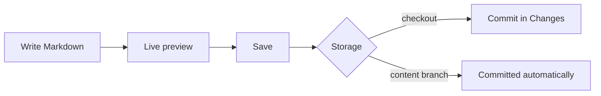

# Wiki

Every page is a Markdown file under the wiki folder (`docs/` by default). Press `E` to edit; the editor shows a live preview next to the source. `Ctrl+S` saves, `Esc` stops editing.

[TOC]

## Pages and subpages

A page and a folder with the same name belong together: `Guide.md` is the page, `Guide/` holds its subpages.

```text
docs/
├── Home.md
├── Guide.md          ← the "Guide" page
└── Guide/
    ├── Wiki.md       ← subpages of "Guide"
    └── Tasks.md
```

A folder without a matching page still shows up and lists its children. Moving a page moves its subpages along.

## Links

- Relative Markdown links: `[Tasks](Tasks.md)`, `[Home](../Home.md#start-here)`. The `.md` may be left out.
- Wiki links by title: `[[Tasks]]` or `[[Tasks|the board]]`. A link to a page that does not exist yet shows in red; clicking it creates the page.
- Links into the code open the file in the editor, links to task files open the task, web links open in your browser.

## Special blocks

| Write | Get |
| --- | --- |
| `[TOC]` or `[[_TOC_]]` | A table of contents of the page |
| `[SUBPAGES]` or `[[_TOSP_]]` | The pages below this one |
| `> [!NOTE]`, `[!TIP]`, `[!IMPORTANT]`, `[!WARNING]`, `[!CAUTION]` | A callout |
| ` ```mermaid ` | A Mermaid diagram |
| ` ```plantuml ` | A PlantUML diagram |
| ` ```ts ` (any language) | Syntax highlighting |

> [!TIP]
> PlantUML diagrams render inside GitDesk with [rockuml](https://github.com/h3ll5ur7er/rockuml); no Java, no server, and the diagram source never leaves your machine. A diagram may start with `@startuml` or contain just the body.

## Diagrams



## Images

Images stored in the repository render inline: ``. Remote images are not loaded automatically; they show as a link.
