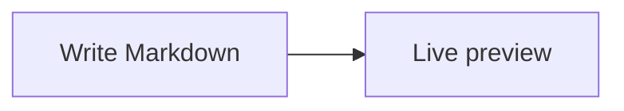
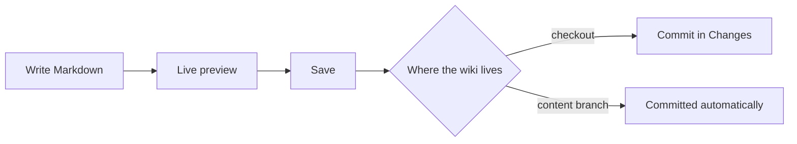

# Wiki

Every page is a Markdown file in the wiki folder (`docs/` unless **Settings** names another). The **Wiki** view (`Ctrl+1`) lists the pages on the left and shows the open one. Pages with a few sections get an outline, *On this page*, beside them when the window is wide enough.

[TOC]

## Writing

- `E` (or **Edit**) opens the editor where you were reading, with a live preview next to the source that scrolls along with it; **Toggle preview** hides and shows it. Leaving the editor returns to the page where the editor was. `Ctrl+S` saves and keeps editing; **Save** saves and closes the editor, and turns into **Done** once everything is saved. `Esc` stops editing.
- `N` (or the button above the page list) creates a page. Write `/` in its name to nest it: `Architecture/Database` becomes a subpage of *Architecture*.
- Type `[[` to link a task, a page or a file — see [References](References.md). Type `@` to mention someone and `//` to insert a date — see [Writing pages](Writing.md).
- Type `/` at the start of a line to insert math, a diagram, a callout, a table and other blocks — see [Writing pages](Writing.md).
- The editor is the same as in **Code**, with find and replace, several cursors and the other keys in [Keyboard shortcuts](Keyboard-shortcuts.md).

A page's file name is its title, with dashes for spaces: `Getting-started.md` is *Getting started*. The home page (`Home.md` unless **Settings** says otherwise) comes first in the list; the others are sorted by title.

Saved pages are ordinary changes: commit them in **Changes**, together with the code they describe. When the wiki lives on the [Content branch](../Architecture/Content-branch.md), every save is committed there right away instead.

## Pages and subpages

A page and a folder with the same name belong together: `Guide.md` is the page, `Guide/` holds its subpages.

```text
docs/
├── Home.md
├── Guide.md          ← the "Guide" page
└── Guide/
    ├── Wiki.md       ← subpages of "Guide"
    └── Tasks.md
```

A folder without a matching page still shows up and lists its children. **New subpage** in a page's `…` menu creates a page below it.

**Move or rename…** in the same menu moves a page together with its subpages. It also offers to update the links that would break: relative links and `[[references]]` to the moved pages from other pages, tasks and Markdown files, and relative links inside the moved pages. The dialog lists every change, and they happen together with the move — in one commit when the wiki lives on the [Content branch](../Architecture/Content-branch.md). References by title keep working as long as the title stays; code blocks are left alone.

## References

`[[…]]` links anything in the repository and shows what it points at, always up to date:

| Write | Shows |
| --- | --- |
| `[[GENBEYA-12]]` | [[GENBEYA-12]] |
| `[[Getting started]]` | [[Getting started]] |
| `[[src/client/app/app.ts#L10-L20]]` | [[src/client/app/app.ts#L10-L20]] |
| `[[GENBEYA-12\|long lists]]` | [[GENBEYA-12\|long lists]] |

`![[src/client/app/app.ts#L1-L5]]` on its own line embeds those lines of the file. [References](References.md) has the whole story: pages by title or path, line ranges, missing pages, task IDs in plain text, and what happens when things move.

## Links

- Relative Markdown links work as on GitHub: `[Tasks](Tasks.md)`, `[Home](../Home.md#start-here)`. The `.md` may be left out.
- Links into the code open the file in **Code**, links to task files open the task, web links open in your browser.

## Special blocks

| Write | Get |
| --- | --- |
| `[TOC]` or `[[_TOC_]]` | A table of contents of the page |
| `[SUBPAGES]` or `[[_TOSP_]]` | The pages below this one |
| `> [!NOTE]`, `[!TIP]`, `[!IMPORTANT]`, `[!WARNING]`, `[!CAUTION]` | A callout |
| ` ```mermaid ` | A Mermaid diagram |
| ` ```plantuml ` | A PlantUML diagram |
| ` ```ts ` (any language) | Syntax highlighting |
| `- [ ]` and `- [x]` | A checklist; its boxes can be ticked as the page reads, which saves the page |
| `[EFFORT]`, `[DEPENDENCIES]`, `[GANTT]` | A plan of the tasks; see [Plans](#plans) |

### Plans

A plan block, alone on its line, shows the tasks as they are now. Nothing is stored in the page, so it never goes stale:

| Write | Get |
| --- | --- |
| `[EFFORT]` | A table of estimate, logged, remaining, forecast and variance per task, with totals, and how many tasks lack an estimate or a remaining effort |
| `[DEPENDENCIES]` | A diagram of what waits for what: a blue border is ready, an orange dashed one blocked, a green one done |
| `[GANTT]` | The tasks with a `due` date on a timeline, one section per epic. Done tasks are greyed, a task that starts before a task it waits for is due is red, and a task with only a due date is a milestone |

Narrow a plan to some tasks with `epic`, `milestone`, `assignee`, `label`, `type` or `status`, all of which must match; quote values with spaces: `[EFFORT epic="Release 1.0" label=cli]`. An epic includes the epics inside it. The fields behind the numbers are described in [Planning](Tasks.md#planning).

[Writing pages](Writing.md) has more: math, code blocks with titles, line numbers and highlighted lines, foldable callouts, footnotes, keys and collapsible sections.

> [!TIP]
> PlantUML diagrams render inside Genbeya with [rockuml](https://github.com/h3ll5ur7er/rockuml): no Java, no server, and the diagram source never leaves your machine. A diagram may start with `@startuml` or contain just the body.

## Diagrams

````markdown

````



## Images

Images stored in the repository render inline: ``, relative to the page. They belong to the wiki, so while the wiki lives on the [Content branch](../Architecture/Content-branch.md), Genbeya loads them from there. Remote images are not loaded; they show as a link.

## Zooming images and diagrams

Large diagrams and screenshots are hard to read at the size of the page. Click one to open it over the window, fitted to it. This works wherever Genbeya shows Markdown: wiki pages, task descriptions and comments, and previews in **Code**.

- The wheel or a pinch zooms around the pointer; drag to move the picture.
- `+` and `-` zoom in and out, `0` fits the picture to the window, `1` shows it at 100 %. The arrow keys move it.
- `Esc`, the close button or a click beside the popup closes it.
- Diagrams stay sharp at any zoom. Images such as screenshots go up to 400 %, beyond which they would only blur.

A diagram's popup switches between **Source**, **Split** and **Diagram**, like the previews in **Code**: the source shows read-only in the editor, to read, search (`Ctrl+F`) and copy. It opens on **Diagram**. Images have no source, so their popup shows just the picture.

An image inside a link follows the link when clicked. Point at it for a zoom button in its corner, which opens the popup instead. Every image and diagram has that button for the keyboard too: `Tab` to it and press `Enter`.
