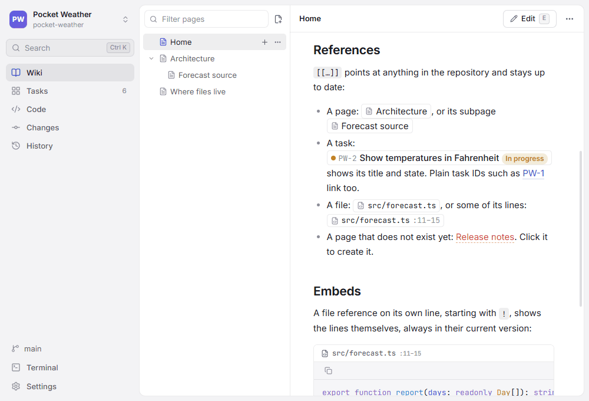

# GitDesk

GitDesk gives one Git repository a wiki, a task board, a code editor, Git tools and a terminal, in one desktop window. Everything it shows is a plain file in the repository — Markdown pages, one Markdown file per task, `.gitdesk.yml` for settings — so it works with any Git host and any other tool, and your project's knowledge travels with its code.

> [!TIP]
> You are reading GitDesk's own wiki. Open this repository in GitDesk to see it as intended: the references below show live titles and states, and the task board holds the real backlog.

[TOC]

## A quick tour

| Area | What you do there | Stored as | Read more |
| --- | --- | --- | --- |
| Wiki | Write pages with a live preview, diagrams and callouts | Markdown files in `docs/` | [Wiki](Guide/Wiki.md) |
| References | Link tasks, pages and files with `[[…]]`, shown with live titles and states | Plain text in any page, task or comment | [References](Guide/References.md) |
| Tasks | Plan on a board or a list, with types, epics, custom fields, comments and activity | One Markdown file per task in `tasks/` | [Tasks](Guide/Tasks.md) |
| Code | Edit any file of the repository | The repository itself | [Code](Guide/Code.md) |
| Search | Find text in pages, tasks and code | — | [Search](Guide/Search.md) |
| Version control | Commit, branch, merge, rebase, stash and resolve conflicts | Git | [Version control](Guide/Version-control.md) |
| Terminal | A shell in the repository, wherever it lives | — | [Terminal](Guide/Terminal.md) |
| Sharing | Send a link that opens a page, task, file or commit in a coworker's GitDesk | — | [Sharing](Guide/Sharing.md) |
| AI agents | Teach coding agents to work with the tasks and the wiki | Skill and instruction files | [AI agents](Guide/AI-agents.md) |
| Settings | Folders, task prefix, workflow, types, fields | `.gitdesk.yml` | [Settings](Guide/Settings.md) |

Repositories can live on this computer, in WSL or on an SSH server; Git always runs where the repository is.

By default, wiki pages, tasks and settings change with the branch you have checked out, like code. A team working on many branches can keep any of them on a shared [Content branch](Architecture/Content-branch.md) instead — for example just the tasks, so everyone sees the same board while the documentation stays with the code.

## Why plain files

- **Reviewable.** A changed task or page is a diff in a pull request, next to the code it describes.
- **Linked.** `[[GENBEYA-14]]` in a page shows the task's title and current status, a missing page shows red, and moving a page updates the links to it — see [References](Guide/References.md).
- **Yours.** No server, no account, no database. Any editor, script or coding agent can read and write the same files.

## Start here

- [Getting started](Getting-started.md) — install, open a repository locally, on WSL or over SSH, and try the sample project
- [Guide](Guide.md) — how to use each area
- [Keyboard shortcuts](Guide/Keyboard-shortcuts.md) — every key on one page
- [Architecture](Architecture.md) — how the app is put together, for contributors
- [Development](Development.md) — build, test and package
